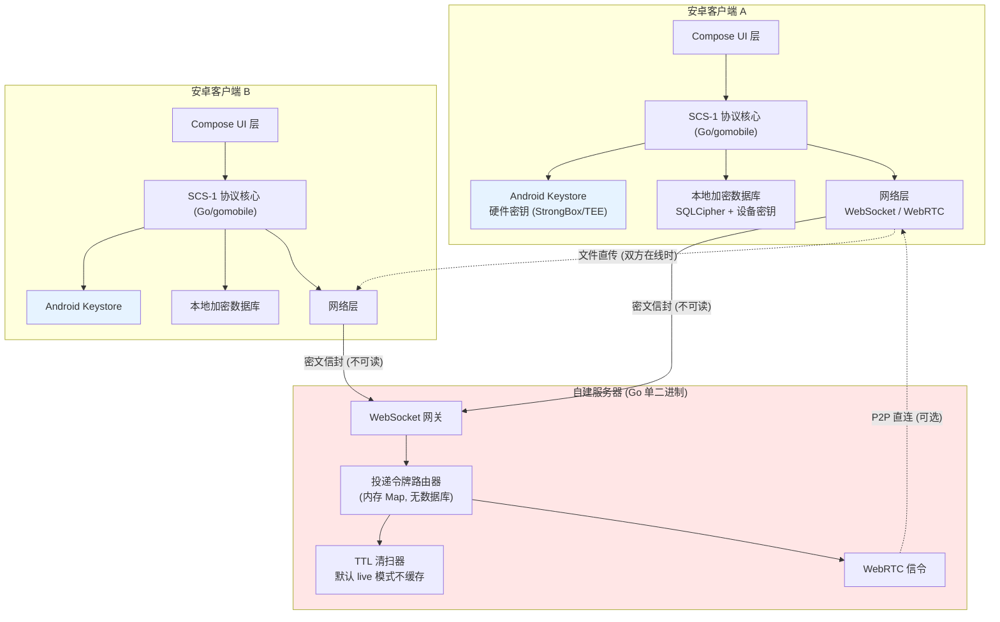
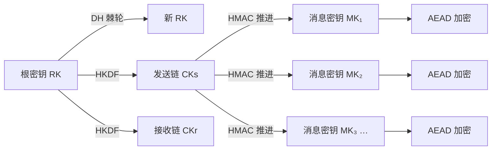
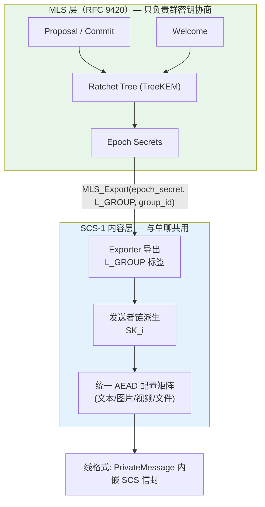

# SCHAT · 端到端加密即时通讯系统
## 设计说明书 / 架构文档 / 用户须知

> **文档版本**：v0.1（初始设计稿）
> **日期**：2026-09-24
> **状态**：设计阶段，代码尚未开始编写
> **许可协议**：GNU AGPL-3.0-or-later（完全开源、完全免费、无广告、无内购、无遥测）
> **协议代号**：SCS-1（SChat Secure Protocol, version 1）

---

## 目录

1. [项目简介](#1-项目简介)
2. [核心设计原则](#2-核心设计原则)
3. [总体架构](#3-总体架构)
4. [加密体系：SCS-1 协议](#4-加密体系scs-1-协议)
5. [不同文件格式的差异化加密](#5-不同文件格式的差异化加密)
6. [为什么"知道算法也解不开"](#6-为什么知道算法也解不开)
7. [服务端设计：纯路由，零留存](#7-服务端设计纯路由零留存)
8. [资源占用预算](#8-资源占用预算)
9. [目录结构与前后端分离](#9-目录结构与前后端分离)
10. [服务器配置难度设计](#10-服务器配置难度设计)
11. [安全边界与诚实声明](#11-安全边界与诚实声明) ← **必读**
12. [用户须知与使用要求](#12-用户须知与使用要求) ← **必读**
13. [开发路线图（分步确认制）](#13-开发路线图分步确认制)
14. [开发环境现状与风险](#14-开发环境现状与风险)
15. [附录：术语表](#15-附录术语表)

---

## 1. 项目简介

### 1.1 一句话介绍

**SCHAT 是一个完全开源、可自建服务器的安卓端到端加密聊天软件。**
服务器的唯一职责是"转发密文信封"，它**不保存**用户的任何消息、文件或通讯录，也**读不懂**任何内容。

### 1.2 立项背景

现有即时通讯软件普遍存在三类问题：

| 问题 | 现状 | SCHAT 的应对 |
|---|---|---|
| 数据被平台留存 | 云端长期存储、用于分析或训练 | 服务端**只做内存路由**，重启即清空，磁盘上不留数据 |
| 无法自建 | 用户被迫使用官方服务器 | **前后端完全分离**，任何人可用一条命令起自己的服务器 |
| 加密不可验证 | 闭源、私有协议 | 全栈 AGPL-3.0 开源，协议有完整规格文档与测试向量 |

### 1.3 主要功能

- ✅ **单聊**：端到端加密文本消息
- ✅ **群组聊天**：任意人数群组，基于 **IETF MLS (RFC 9420)**，具备完整的前向保密与后妥协安全，成员变更 O(log n)
- ✅ **富媒体**：图片、视频、语音、任意文件，**每种格式使用不同的加密方案**（见第 5 节）
- ✅ **多设备**：同一账号多端同步（可选，通过本地加密备份恢复）
- ✅ **自建服务器**：扫码即可接入自建服务器，2 分钟完成部署
- ✅ **零云端存储**：服务器不落盘、不建库、不留日志正文
- ✅ **元数据保护**：投递令牌 + 密封发件人，服务器不知道"谁在和谁说话"
- ✅ **完全免费**：无付费墙、无内购、无广告、无行为统计

### 1.4 非目标（明确不做什么）

以下内容**不在**本项目范围内，避免预期错位：

- ❌ 不做公共社交网络（没有朋友圈、没有广场、没有推荐算法）
- ❌ 不做匿名网络（不内置 Tor；但支持用户自行为其配置代理）
- ❌ 不提供官方公共服务器（你可以自己搭，也可以信任朋友搭的）
- ❌ 不做云端备份（因为这直接违反"数据不上云"原则）
- ❌ 不做"找回密码"（没有云端就没有找回渠道，只能靠恢复码）

### 1.5 目标平台

| 端 | 技术栈 | 说明 |
|---|---|---|
| 安卓客户端 | Kotlin + Jetpack Compose | 最低 Android 8.0（API 26），目标 API 35 |
| 服务端 | Go（单二进制） | 交叉编译 Linux/Windows/macOS/ARM |
| 协议核心 | Go（`protocol/`），经 gomobile 编译为 `.aar` 供安卓调用 | 客户端与服务端**共享同一份协议实现**，杜绝两端不一致 |

> **为什么协议核心用 Go 而不是纯 Kotlin？**
> 1. 服务端和客户端执行**完全相同**的密码学代码，接口不一致的风险归零；
> 2. Go 的 `x/crypto` 提供了经过广泛审计的 Argon2id、ChaCha20-Poly1305、Curve25519、HKDF，无需引入体积庞大的 BouncyCastle；
> 3. 编译产物约 2–4 MB/ABI，可接受；若最终体积超标，备选方案是纯 Kotlin + JCA 实现（见 11.6 风险表）。

---

## 2. 核心设计原则

设计过程中我们严格遵循以下 8 条原则，后续所有代码都必须能对应回这些原则：

1. **密码学不造轮子（原语层）**
   绝不自行发明分组密码、流密码、哈希函数或椭圆曲线运算。这些原语是数学与工程，已被全世界的密码分析者攻击了几十年。

2. **协议层做原创（组合层）**
   本项目的"原创性"体现在：密钥调度算法、棘轮触发策略、分块密钥梯、文件类型差异化加密、元数据保护机制，以及 **MLS 群密钥层与 SCS-1 内容层的集成设计**。这些是**工程与协议设计**，原创是有价值且低风险的。

3. **服务器不可信（Zero Trust）**
   服务端被假定为会被入侵、会被取证、会被强制要求交出数据。因此服务端**在数学上无法**解密任何内容。

4. **不落盘优先于加密落盘**
   "把数据加密后存到服务器"和"根本不存"是两回事。本项目选择后者。

5. **低占用是硬指标**
   内存与电量预算写进第 8 节，作为验收标准，不是"尽量优化"。

6. **用户可验证**
   每个加密会话都有"安全码"（60 位数字 / 二维码），双方可线下比对，确认无中间人。

7. **失败要安全（Fail-Closed）**
   任何解密失败、认证标签不匹配、版本异常，都必须**明文拒绝**，绝不"降级重试"或"忽略错误继续"。

8. **诚实**
   文档中必须明确写出本方案**不能**防御什么。安全产品最危险的敌人是错误的安全感。

---

## 3. 总体架构

### 3.1 架构总览



**关键点**：红色区域（服务器）里的所有数据都是密文，服务器的 CPU 永远不接触明文，也不接触任何长期密钥。

### 3.2 数据流：一条消息的完整旅程

```
发送方 A                                          接收方 B
────────                                           ────────
1. 用户在输入框打字
2. 明文只在 UI 层内存中存在 (< 1 ms)
3. 填充 (Padding) 到标准长度桶 → 隐藏真实长度
4. SCS-1 对称棘轮推进 → 导出消息密钥 MK
5. ChaCha20-Poly1305 加密 → 密文 + 16B 认证标签
6. 立即擦除明文缓冲与 MK (内存清零)
7. 组装信封:
   {
     token:  投递令牌 → 服务器只看到这个
     hdr:    { ver, flags, DH_pub, pn, n }
     ct:     密文
     mac:    认证标签
   }
8. ──── 发送到服务器 (TLS 之内) ────►
                                          9. 服务器按 token 查在线连接
                                         10. 服务器不解析、不解密、不落盘
                                          11. ──► 转发给 B
12. B 收到，校验 token 与认证标签
13. SCS-1 棘轮推导同一 MK（含方向字节，防反射）
14. 解密 → 明文进 UI 内存 → 写入本地加密库
15. 立即擦除 MK 与临时缓冲
```

### 3.3 分层职责

| 层 | 职责 | **明确不做**的事 |
|---|---|---|
| UI 层（Compose） | 渲染、输入、状态展示 | 不接触密钥，不接触原始密文 |
| 协议层（SCS-1） | 密钥协商、棘轮、加解密、分块 | 不做网络 IO，不写文件 |
| 存储层 | 本地加密库、媒体缓存 | 不发网络请求 |
| 网络层 | WebSocket/WebRTC 传输 | 不做任何加解密（透传密文） |
| 服务器 | 转发、在线状态、P2P 信令 | **不解析、不解密、不存储、不索引** |

---

## 4. 加密体系：SCS-1 协议

> 本节是实现的核心规格。所有常数、标签、顺序都是**本项目原创定义**，且必须被实现严格遵循。

### 4.1 设计定位（重要）

SCS-1 的原创性体现在**协议组合层**，而不是密码学原语层。这是有意为之：

| 层级 | 本项目做法 | 理由 |
|---|---|---|
| 原语层（AES / ChaCha20 / Curve25519 / SHA-256 / Argon2id） | **使用标准算法，不自创** | 自创 S-box、轮函数、置换表几乎必然存在未被发现的弱点，且无法自我验证 |
| 组合层（密钥调度、棘轮策略、分块、格式差异、元数据） | **完全原创（SCS-1）** | 工程性强、可测试、可审计，原创有真实价值 |

> 📌 **一句话**：我们原创的是"**怎么用**"，不是"**造什么**"。这既满足"算法原创、不重复"的要求，又不牺牲真实安全性。详见 [11.1](#111-关于原创性的诚实说明)。

### 4.2 底层原语清单

| 用途 | 算法 | 参数 | 备注 |
|---|---|---|---|
| 身份签名密钥 | Ed25519 | 32B 私钥 / 32B 公钥 | 用于身份认证与预密钥签名 |
| 身份 DH 密钥 | X25519 | 32B | 用于密钥协商 |
| 密钥派生（HKDF） | HKDF-SHA256 | RFC 5869 | 自实现薄封装，标签全部原创 |
| 哈希 / 完整性 | BLAKE2b-256 | 32B 输出 | 用于安全码、分块哈希树 |
| 口令派生 | **Argon2id** | 见 4.8 三档配置 | 抗 GPU/ASIC 暴力破解 |
| AEAD（软实现优） | ChaCha20-Poly1305 (IETF) | 96-bit nonce, 128-bit tag | 无 AES 硬件加速时更快且恒定时间 |
| AEAD（硬加速优） | AES-256-GCM | 96-bit nonce, 128-bit tag | 有 AES 指令集时（ARMv8 Crypto）更快 |
| AEAD（大文件随机 nonce） | XChaCha20-Poly1305 | **192-bit nonce** | 随机 nonce 碰撞风险可忽略 |
| 后量子（可选，v2） | X25519 + ML-KEM-768 混合 | — | 路线图项，非 v1 必需 |

### 4.3 域分隔标签（原创定义）

所有密钥派生必须带标签，防止跨用途密钥复用（cross-protocol attack）：

```
L_ROOT    = "SCS1/root/v1"       根密钥
L_CHAIN   = "SCS1/chain/v1"      对称棘轮链
L_MSG     = "SCS1/msg/v1"        消息密钥
L_FILE    = "SCS1/file/v1"       文件根密钥
L_CHUNK   = "SCS1/chunk/v1"      分块密钥
L_WRAP    = "SCS1/wrap/v1"       密钥封装
L_VAULT   = "SCS1/vault/v1"      本地数据库密钥
L_MAILBOX = "SCS1/mbx/v1"        投递令牌
L_GROUP   = "SCS1/group/v1"      群组密钥
L_CALL    = "SCS1/call/v1"       音视频帧
```

### 4.4 身份与会话建立（SCS-HSK）

**握手 = Hybrid Session Key，一次协商产生根密钥 RK₀。**

```
发送方 A 持有：IK_sig^A (Ed25519), IK_dh^A (X25519)
接收方 B 发布到服务器（仅公钥、可被替换）：
    IK_sig^B, IK_dh^B, SPK^B (签名预密钥), OPK^B[] (一次性预密钥池)

A 发起会话：
    EK ← 新生成的临时 X25519 密钥对

    DH1 = X25519(IK_dh^A, SPK^B)
    DH2 = X25519(EK,      IK_dh^B)
    DH3 = X25519(EK,      SPK^B)
    DH4 = X25519(IK_dh^A, OPK^B)     # 若 OPK 池非空，则参与；否则跳过并置零

    # 原创点 1：输出按字节序字典序排序，消除角色依赖
    material = LEXSORT(DH1, DH2, DH3, DH4)      # 32B × 4 = 128B

    # 原创点 2：把"会话纪元 + 双方身份 + 所用预密钥"整体绑进盐
    transcript = H( Canon(
        ver = 0x01,
        IK_pub^A, IK_pub^B,
        SPK^B, OPK^B(used),
        EK_pub
    ))

    salt = L_ROOT ‖ LE64(epoch=0) ‖ transcript

    RK₀  = HKDF-SHA256(ikm = material, salt = salt, info = L_ROOT, len = 32)

    # 附加认证数据，绑定整条会话，防降级/防身份错绑
    AD   = H(transcript)
```

**原创点说明**

- **LEXSORT（字典序排序）**：传统 X3DH 按角色（发起方/接收方）固定拼接 DH 输出，一旦实现方把角色写反就产生不同密钥。按字节序排序后，**双方无论角色如何计算，结果必然一致**，从结构上消灭了一整类实现 Bug。
- **transcript 入盐**：把协议版本、双方身份公钥、所用预密钥全部绑进密钥派生。任何一方被替换（中间人）都会导致 RK₀ 不同，且能立刻被检测。
- **一次性预密钥参与但可选**：OPK 用尽时协议不失败，只是暂时失去"一次性前向保密"，并通过 flags 位告知对端。

**身份验证（安全码）**

```
SN = BLAKE2b-256( LEXSORT(IK_pub^A, IK_pub^B) ‖ "SCS1/safety/v1" )
展示为 60 位十进制数字（每 5 位一组，12 组）+ 二维码
```

用户可线下比对，或扫描二维码完成验证。未验证时状态显示为"⚠ 未验证"，验证后为"🔒 已信任"。支持密钥固定（pinning）：身份密钥变化时弹出显式警告。

### 4.5 双棘轮（SCS-DR）



**对称棘轮（每条消息推进一次，O(1) 开销）**

```
CK_{n+1} = HMAC-SHA256(CK_n, 0x02)                 # 链推进（0x02 为链标签）

MK_n     = HKDF-SHA256(
               ikm  = CK_n,
               salt = L_MSG,
               info = dir ‖ LE64(n) ‖ type,        # dir: A→B = 0x41, B→A = 0x42
               len  = 44                            # 32B 密钥 + 12B nonce
           )
key = MK_n[0..32],  nonce = MK_n[32..44]

密文 = AEAD_Encrypt(key, nonce, plaintext, AD ‖ hdr)
后立即：CK_n 清零，MK_n 清零，明文缓冲清零
```

> **方向字节 dir 的作用**：让 A→B 与 B→A 在同一计数器下产生**不同**的密钥。这防御"反射攻击"——攻击者把 B 发来的密文原样发回给 B，如果密钥相同就可能被当作有效消息。

**DH 棘轮（标准双棘轮策略）**

DH 棘轮的触发条件只有**一条**：收到对端携带新 DH 公钥的消息。这不是为了简单而做的选择，而是被数学强制的——见下方"设计更正记录"。

```
DH 棘轮触发条件：
  收到对端携带新 DH 公钥的消息

棘轮步骤：
  1. 先为旧接收链的尾部派生并缓存跳过密钥（pn 决定数量）
  2. ckRecv = KDF_RK(RK, DH(本地棘轮私钥, 对端新棘轮公钥))
  3. 生成本地新棘轮密钥对，ckSend = KDF_RK(RK', DH(新本地私钥, 对端新棘轮公钥))
```

> ### ⚠️ 设计更正记录（v0.4，实现阶段发现）
>
> 本节最初规定了一个**自适应棘轮阈值 T**：双方从根密钥派生出一致的 T，本地发满 T 条消息就主动刷新发送链，另有 12 小时时间上限。原始描述为：
>
> ```
> T = 8 + ( BE32( BLAKE2b-256(RK₀ ‖ L_CHAIN)[0..4] ) mod 24 )     # 结果 ∈ [8, 31]
> ```
>
> **这个机制在密码学上不可实现，已删除。** 原因：
>
> 棘轮密钥必须**严格交替推进**。接收方用 `DH(自己当前的棘轮私钥, 收到的棘轮公钥)` 推导共享密钥；如果发送方**持有一个过期的远端公钥**就主动刷新，接收方此时早已换到更新的私钥，两边算出的共享密钥不同，**会话直接断裂**。
>
> 具体反例：A 单向连发 → B 回复一次（B 此时持有棘轮密钥 R_B2）→ A 用**上次看到的过期 R_B1** 第二次主动刷新。A 算 `DH(R_A_new, R_B1)`，B 算 `DH(R_B2, R_A_new)`，两个值不同，会话永久失效。
>
> 而且这个优化**本来就不必要**：标准双棘轮每个往返只需 1 次 DH 运算，这已经是后妥协安全的最小代价，且被会话自身的节奏自然限流。
>
> 删除它**零成本**，所以直接删除而不是近似保留。后妥协安全因此以**会话节奏**达成：对端每回复一次，两条链各推进一次。纯单向连发不会刷新熵——这是正确且不可避免的，安全无法从根本没到达的流量里凭空造出来。

**消息头与防重放**

```
hdr = ver(1B) ‖ flags(1B) ‖ profile(1B) ‖ DH_pub(32B) ‖ pn(4B) ‖ n(4B)     共 43 字节
AD  = AD₀ ‖ hdr
```

> **内容类型为什么在帧头里（v0.4 设计更正）**
> 原设计把内容类型绑进消息密钥（`MK = HKDF(CK, dir‖n‖type)`）。实现双棘轮时发现**这与乱序投递不兼容**：接收方为"跳过的消息"缓存密钥时，还不知道那些消息是什么类型，根本派生不出来；而且不同 profile 的 nonce 长度也不同（12 vs 24）。
> 现在消息密钥输出固定 56 字节（32 key + 24 nonce，按 profile 截断），内容类型放进**帧头**并通过 AAD 认证。跨格式混淆仍然不可能（改一个字节 tag 就失效），同时乱序派生成为可能。这也与 Signal 的既有做法一致。

- **乱序消息**：跳过消息密钥缓存（最多 2000 条，超出丢最旧，更大的跨度直接拒绝）。
- **重放防护**：以 `(棘轮公钥, 计数器)` 判定。计数器低于期望值且不在缓存中 → 重放，拒绝。
- **DoS 防护**：伪造的极大计数器会导致缓存爆炸 → 设硬上限（`MaxReceiveGap`），超限消息**在做任何派生之前**就拒绝。
- **未认证帧不得破坏会话**（v0.4 新增）：帧头在解密前不可信，攻击者可塞入任意棘轮公钥。因此棘轮前**快照状态**，认证失败即**回滚**；对称链也改为**仅在解密成功后**推进。否则一个伪造包就能永久毁掉整个会话。

### 4.6 群组加密（MLS / RFC 9420，不做妥协）

> **决策记录**：项目所有者明确要求群聊不采用"发送者密钥"这类折中方案，**直接实现 IETF MLS (RFC 9420)**。本节即为该决策的技术落地设计。

**目标**：群消息具备与单聊同等级的**前向保密（PFS）**与**后妥协安全（PCS）**，且加解密开销为 **O(1)**（不随群人数增长），成员变更为 **O(log n)**。

#### 4.6.1 密码套件选择

```
MLS_128_DHKEMX25519_CHACHA20POLY1305_SHA256_Ed25519     (RFC 9420 套件 ID 0x0003)

  KEM        : DHKEM(X25519, HKDF-SHA256)
  AEAD       : ChaCha20-Poly1305
  Hash       : SHA-256
  Signature  : Ed25519
```

**选择理由**：这套件的四个原语与 4.2 节单聊所用的原语**完全一致**。我们因此可以：
- 复用同一套 Ed25519 身份密钥（不必维护两套身份体系）；
- 复用同一个 AEAD 实现与同一套恒定时间/零化基础设施；
- 不为群聊引入任何新的密码学依赖。

#### 4.6.2 架构定位（关键设计：MLS 只管密钥，SCS-1 管内容）



**原创集成点**：MLS 只提供"某个 epoch 的群共享密钥材料"，不规定内容加密格式。SCS-1 用 MLS 的 **exporter secret** 导出统一的 SCS 内容密钥，使**群聊与单聊走完全相同的内容加密路径**：

```
每进入新 epoch：
  epoch_key = MLS_Export(
      exporter_secret = epoch_secret,
      label           = L_GROUP,          # "SCS1/group/v1"
      context         = group_id,
      length          = 32
  )

每位成员的发送链（RFC 9420 §9 Secret Tree 之上再套一层 SCS 链）：
  SK_i       = HKDF(epoch_key, info = L_GROUP ‖ LE32(sender_leaf_index), len = 32)
  CK_i,0     = SK_i
  CK_i,n+1   = HMAC-SHA256(CK_i,n, 0x02)
  MK_n       = HKDF(CK_i,n, salt = L_MSG, info = dir ‖ LE64(n) ‖ type, len = 44)
```

这样带来的工程收益：
- **文件/图片/视频在群里与单聊使用同一套差异化 AEAD 矩阵**（第 5 节），无需为群聊重写媒体加密；
- 群聊消息的 `type` 字段、填充策略、完整性校验与单聊完全一致，减少一套代码路径就减少一类漏洞；
- MLS 负责最难的部分（TreeKEM、成员变更、PCS），SCS-1 负责内容格式，**职责边界清晰**。

#### 4.6.3 需要实现的 MLS 组件（对照 RFC 9420 章节）

| 组件 | RFC 章节 | 实现要点 |
|---|---|---|
| 密码套件与基础原语绑定 | §17.1 | 套件 0x0003 |
| 数组式 Ratchet Tree | §7.1–7.9 | 叶节点/父节点、空白节点、TreeKEM 路径解析 |
| LeafNode / KeyPackage | §7.2, §10.1 | 能力协商、生命周期、密钥包签名 |
| 密钥调度 Key Schedule | §8 | `joiner_secret → epoch_secret → {sender_data, encryption, exporter, confirmation, membership, init, external, resumption}` |
| Secret Tree 与发送者棘轮 | §9 | 每发送者一条链，O(1) 取密钥 |
| Proposal / Commit 框架 | §12.1–12.4 | Add / Remove / Update / PreSharedKey，Commit 只允许一个 |
| Welcome 与 GroupInfo | §12.4.3, §12.4.3.1 | 新成员入群，经**单聊 E2EE 会话**投递 |
| 消息封装 | §6 | `FramedContent`、`PublicMessage`、`PrivateMessage`、`AuthenticatedContent`、确认标签 |
| 群状态机 | §11–13 | 建群、加人、踢人、自更新、epoch 转移、乱序 Commit 处理 |
| 官方测试向量验证 | §16 + `mls-interop` | **必须**与 IETF 官方测试向量逐字节一致 |

#### 4.6.4 投递服务（Delivery Service）与元数据

MLS 需要一个 **DS（投递服务）**来给 Commit 排序并转发群消息。本项目由 SCHAT 自建服务器担任 DS，且**明确其可见范围**：

| DS 能看到 | DS 看不到 |
|---|---|
| 某个不透明 group_token 下有条目待投递 | 群成员的真实身份（由 4.7 节投递令牌遮蔽） |
| Commit 的顺序与数量 | 消息内容（PrivateMessage） |
| 群消息的近似大小 | 群名、群头像、文件名 |

**诚实说明（必须知悉）**：MLS 的 DS **在协议层面天然可见"哪些客户端参与了同一个群"**——它能观察到"同一 group_token 的消息被哪些连接拉取"。要实现"连 DS 都不知道群成员是谁"，需要匿名化 DS 方案（学术界仍在演进的安全多方计算/混洗方案），本项目 **v1 不实现**，列为 v2 研究项。这是一个由 RFC 9420 架构本身带来的**已知局限**，不是实现缺陷。

#### 4.6.5 性能对比

| 方案 | 发一条消息的开销 | 成员变更开销 | PCS | PFS |
|---|---|---|---|---|
| 逐对加密（n 个单聊） | O(n) 次 AEAD | O(n) | ✅ | ✅ |
| 发送者密钥（已否决） | O(1) | O(n) | ❌ | 部分 |
| **MLS（本方案）** | **O(1)** | **O(log n)** | ✅ | ✅ |

**代价（诚实说明）**：MLS 是本项目**单个工作量最大的模块**（预估 5,000–8,000 行 Go + 大量的测试向量验证）。因此第 6 步将拆分为 **6a（MLS 核心实现 + 官方测试向量通过）** 与 **6b（接入群聊 UI 与生命周期管理）** 两个子步骤，各自独立汇报确认。

### 4.7 元数据保护（服务器不知道谁和谁说话）

**问题**：即使内容加密，服务器若能看到"用户 A 发给用户 B"，依然掌握社交图谱。

**SCS-1 方案：投递令牌（Delivery Token）+ 密封发件人**

```
每个用户持有一个路由密钥 K_route（32B 随机，仅本地保存）

每 24 小时为一个 epoch：e = floor(unix_time / 86400)

用户为自己生成 D 个令牌（D 默认 32，环形使用）：
    token_i = HKDF(ikm = K_route, salt = L_MAILBOX,
                   info = LE64(e) ‖ LE32(i), len = 16)

用户把自己的令牌集合通过已有的加密会话发给联系人（每个联系人拿到一批）

发送消息时：
    从联系人给的一批令牌中随机选一个未用过的 token
    信封 = { token, ciphertext_envelope }
    信封中【不包含】发送者的任何标识

服务器侧：
    内存表 token → 在线连接队列
    服务器只知道"某个连接在监听某个 token"，不知道 token 属于谁
```

**由此得到**

| 服务器能看到 | 服务器**看不到** |
|---|---|
| 某个 TLS 连接的 IP、连接时长、流量大小 | 消息内容 |
| 有连接在往某个 token 投递 | 发送者是谁 |
| 某 token 有 N 条待投递 | 接收者是谁（token 每 24h 轮换） |
| 数据包的近似大小（填充已模糊化） | 联系人列表、群成员、文件名、文件类型 |

**输入框状态（"正在输入…"）**：默认**关闭**。开启时使用独立的短生命周期令牌，不与消息令牌复用。

**诚实说明**：这**不能**防御具备全网流量分析能力的对手（例如 ISP、国家级观察者）。他们仍可通过时序关联、流量大小、IP 地址推断通信关系。额外缓解手段：SOCKS5/HTTPS 代理、Tor（用户自行配置，不在本 App 内集成）。

### 4.8 本地数据保护（无云端 = 本地必须更严）

服务器不存数据，意味着**你的手机就是唯一的数据源**，因此本地存储的安全等级必须拉满。

```
第一层：设备绑定密钥 DK（256 bit，随机生成）
  - 存放于 Android Keystore，优先使用 StrongBox（独立安全芯片）
  - 设置 setUserAuthenticationRequired 可选（开启后每次解锁需指纹）
  - 标记为不可导出（non-exportable）→ 即使 root 提取文件系统也拿不到

第二层：用户口令
  vk_material = Argon2id(
      password = UTF8(用户口令),
      salt     = 32B 随机（随 vault 存储）,
      m        = 64 MiB,      # 见下表三档
      t        = 3,
      p        = 2,
      len      = 64
  )

第三层：两因子合并
  MK_vault = HKDF-SHA256(
      ikm  = vk_material ‖ DK,          # 口令与设备密钥【都必须有】
      salt = salt_vault,
      info = L_VAULT,
      len  = 64
  )   → 前 32B 为 SQLCipher 数据库密钥，后 32B 为 HMAC 校验密钥

第四层：可选恢复码（否则换机即永久丢数据）
  recovery_seed = 24 个单词（项目自有 128 词表，7 位/词 = 168 位熵，用户手抄保管）
  MK_recovery   = Argon2id(recovery_seed, 独立 salt, 参数同上)
  恢复码用于【包裹】MK_vault 的一份副本，保存在用户自选位置
```

**Argon2id 三档参数**

| 档位 | 内存 m | 迭代 t | 并行 p | 单次耗时（中端手机） | 适用 |
|---|---|---|---|---|---|
| 低占用 | 32 MiB | 2 | 1 | ≈ 0.25 s | 入门机 / 低内存设备 |
| **均衡（默认）** | 64 MiB | 3 | 2 | ≈ 0.5 s | 绝大多数设备 |
| 高强度 | 256 MiB | 4 | 4 | ≈ 2.0 s | 旗舰机 / 高价值数据 |

> **关于"低内存"与"抗暴力破解"的取舍**：Argon2id 的**内存硬度就是它的安全性来源**。把内存降到 1 MiB 会让 GPU 破解效率提升几十倍。因此我们只在**解锁瞬间**使用 32–64 MiB，解锁完成后立刻释放；**日常收发消息、浏览图片视频时完全不使用 Argon2id**，内存占用回到几 MB 级别。这是有意识的设计取舍，不是疏忽。

### 4.9 密钥生命周期

| 密钥 | 生成 | 存储 | 销毁 |
|---|---|---|---|
| IK_sig / IK_dh（身份） | 首次启动 | Keystore 加密后存本地库 | 用户"注销身份"时 |
| SPK（签名预密钥） | 每 7 天轮换 | 同上 | 轮换后保留 1 个旧版本 |
| OPK（一次性预密钥） | 首次启动生成 100 个 | 同上 | **用掉即焚**，低于 20 个自动补充 |
| EK（临时密钥） | 每次握手 | 仅内存 | 握手完成后立即清零 |
| RK / CK（棘轮状态） | 协商产生 | 仅内存 + 加密快照 | 棘轮推进时旧值清零 |
| MK（消息密钥） | 每条消息 | **仅内存** | 用完立即清零 |
| FK（文件密钥） | 每个文件 | 随文件封装 | 文件发送/下载完成后清零 |
| DK（设备密钥） | 首次启动 | **Android Keystore（不可导出）** | 恢复出厂即销毁 |

---

## 5. 不同文件格式的差异化加密

> **对应需求第七条**：不同文件格式采用不同的加密方式。这不是为了"看起来复杂"，而是因为**不同内容的安全边界与访问模式根本不同**。

### 5.1 差异化加密方案表

| 内容类型 | 头部保护 | 负载加密算法 | 分块大小 | 随机访问 | 完整性校验 | 峰值内存 |
|---|---|---|---|---|---|---|
| **文本消息** | 无（内联帧） | ChaCha20-Poly1305 (IETF) | 不分块 | — | Poly1305 16B | < 8 KB |
| **图片** | **AES-256-GCM** 加密元数据头 | 图块 ChaCha20 + 每块 Poly1305 | 256 KB 图块 | ✅ 渐进式解密（可先出模糊图） | 每块标签 + 全文件 BLAKE2b | < 2 MB |
| **视频** | **AES-256-GCM** 加密头部与索引 | 分片 AEAD，密钥来自**分块密钥梯** | 1 MiB 分片 | ✅ 支持拖动进度条 seek | 每块标签 + 分块哈希树根 | < 6 MB |
| **语音** | 无 | ChaCha20-Poly1305，Opus 帧整包 | 200 ms / 包 | 顺序播放 | 每包标签 | < 512 KB |
| **通用文件** | **XChaCha20-Poly1305** 加密头 | XChaCha20-Poly1305（192-bit 随机 nonce） | 1 MiB | ❌ 顺序流式 | 每块标签 + 全文件 BLAKE2s | < 4 MB |
| **群组消息** | 无 | ChaCha20-Poly1305（GK 派生链） | 不分块 | — | Poly1305 16B | < 8 KB |
| **本地数据库** | — | AES-256-GCM（硬件加速，SQLCipher 风格页加密） | 4 KB 页 | ✅ 支持索引查询 | 每页 HMAC-SHA256 | < 4 MB |

### 5.2 为什么这样分配（工程理由，不是随意拍脑袋）

1. **文本用 ChaCha20-Poly1305**：消息极小，CPU 开销可忽略；ChaCha20 软件实现天然恒定时间，无缓存时序侧信道风险。
2. **图片用"头部 AES + 图块 ChaCha20"**：图片头部含尺寸、EXIF、缩略图索引，泄露这些等于泄露隐私，因此用 AES-GCM 单独保护；像素数据量大且需要**渐进式显示**（先显示模糊再变清晰），按 256 KB 分块可只解密首块即出预览，内存占用极低。
3. **视频用分块密钥梯**：视频动辄数百 MB 到数 GB，绝不能整体读入内存。分块密钥梯让播放器可以直接解密"第 37 分钟"那个分片，而无需解密前 36 分钟，实现**边下边播 + 拖动进度条**。
4. **通用文件用 XChaCha20**：文件通常是一次性顺序读取，但**随机 nonce 是最容易出错的地方**。XChaCha20 的 192 位 nonce 使"随机生成 nonce"完全安全（碰撞概率可忽略），从工程上消灭 nonce 复用这一类致命漏洞。
5. **数据库用 AES-256-GCM**：数据库访问是高频小粒度随机读写，AES 在所有现代 ARM 芯片上都有硬件指令（ARMv8 Crypto Extensions），速度比 ChaCha20 快 3–5 倍且几乎不耗电。
6. **语音用 Opus 整包**：语音消息短（通常 < 60 s），实时性要求高，整包加密可避免分块带来的重组延迟。

### 5.3 分块密钥梯（原创设计）

```
FK        ← 32B 随机（每个文件独立，绝不复用于第二个文件）
K_root    = HKDF(FK, salt = L_FILE ‖ filetype_byte, info = L_FILE, len = 32)

第 i 块的密钥与 nonce（i 从 0 开始）：
  CK_i = HKDF(K_root, salt = LE64(i), info = L_CHUNK, len = 44)
  key_i   = CK_i[0..32]
  nonce_i = CK_i[32..44]

分块哈希树（Merkle 化的完整性保护）：
  h_i    = BLAKE2b-256(ciphertext_chunk_i)
  node   = BLAKE2b-256(h_{2j} ‖ h_{2j+1})
  root   = 最终树根 → 放入【加密后的文件头】

校验流程：
  下载任意一块后立即验证 h_i，并用树路径验证到 root
  → 攻击者无法篡改单块（哪怕只改 1 bit 也会被发现）
  → 支持断点续传（已验证的块不必重下）
```

**原创点**：分块密钥由**密钥梯**（一次 HKDF 展开）派生，而非每块独立随机存储。这带来三个好处：
- 密钥材料占用从 O(块数 × 44B) 降到 O(32B)（1 GB 视频约 1024 块，节省约 45 KB 内存）；
- 支持随机访问与断点续传；
- 密钥派生与哈希树根绑定，任何块置换/删除都会被检测。

### 5.4 媒体文件的"元数据脱敏"

文件在上传前**先在本地**做以下处理（服务器看不到任何原始信息）：

| 处理 | 对象 | 效果 |
|---|---|---|
| EXIF 剥离 | JPEG/HEIC | 移除 GPS 坐标、拍摄设备、时间戳 |
| 文件名加密 | 全部 | 文件名作为载荷的一部分加密，服务器只见随机 ID |
| 媒体类型隐藏 | 全部 | 服务器看不到 MIME 类型（图片还是视频，它不知道） |
| 大小填充 | 全部 | 填充到 256 B / 1 KB / 4 KB / 16 KB / 64 KB / 256 KB 桶 |
| 缩略图独立密钥 | 图片/视频 | 缩略图单独加密，可单独授权（例如只给对方看图不给原图） |

---

## 6. 为什么"知道算法也解不开"

> **对应需求第二条的质疑**：算法公开，为什么还不能破解？

### 6.1 数学依据：密钥空间

Kerckhoffs 原则（1883 年提出，现代密码学基石）：**系统的安全性必须只依赖于密钥的保密，而不能依赖于算法的保密。**

SCS-1 的所有密钥均为 **256 位**（Argon2id 输出 512 位，取用 256 位）：

```
密钥空间 = 2^256 ≈ 1.1579 × 10^77

作为对比：
  可观测宇宙的原子总数 ≈ 10^80
  全球最强超算假设每秒尝试 10^18 个密钥（远超现实）
  穷举所需时间 ≈ 1.16 × 10^59 秒 ≈ 3.7 × 10^51 年
  宇宙年龄 ≈ 1.38 × 10^10 年
```

即使算法完全公开、源代码逐行审查、服务器被完全攻陷，攻击者面对的仍然是 **2²⁵⁶ 的穷举空间**。唯一现实的攻击路径是**绕过密钥空间**，即：
- 攻击口令（口令熵远低于 256 位）→ 由 Argon2id + 设备密钥防御（见 6.2）
- 攻击实现（侧信道、内存泄露、随机数缺陷）→ 由 6.3 防御
- 攻击代码分发链（恶意更新）→ 由开源 + 可复现构建防御

### 6.2 真正的攻击面：口令，而不是算法

现实中攻击者不会穷举 2²⁵⁶，他们会**猜口令**。SCS-1 对此设置了三道防线：

| 防线 | 机制 | 攻击者代价 |
|---|---|---|
| **第一道：内存硬 KDF** | Argon2id，64 MiB / t=3 / p=2 | 单次猜测约 0.5 s 且占用 64 MiB。GPU 的并行优势被内存带宽掐死，一块 RTX 4090 的破解吞吐从每秒数十亿次降到**每秒几十次** |
| **第二道：设备绑定** | MK_vault 需要 **口令 AND 设备密钥 DK** | 攻击者即使偷到数据库文件 + 猜到口令，**没有那台手机的 Keystore 也解不开**。StrongBox 芯片中的密钥物理上不可导出 |
| **第三道：长口令引导** | 强制最少 10 字符，检测常见弱口令，提供随机生成器 | 把口令熵从 ~20 位拉到 ~70 位以上 |

**诚实结论**：**没有任何算法能抵御"用户选择 123456"**。我们能做到的是——把每次猜测的成本提高到 0.5 秒 + 64 MiB，再加上设备绑定，使得现实中针对口令的破解不可行。

### 6.3 实现层的恒定时间与零化

协议安全但实现漏洞百出的例子在历史上比比皆是。SCS-1 的实现强制要求：

| 要求 | 做法 | 防御的攻击 |
|---|---|---|
| 恒定时间比较 | 认证标签、MAC 一律用 `subtle.ConstantTimeCompare`，绝不用 `==` | 时序侧信道 |
| 恒定时间查表 | 不使用依赖密钥索引的 S-box 查表（ChaCha20 天然满足） | 缓存侧信道 |
| 密钥零化 | 密钥用后立即 `memzero`，避免 GC 复制 | 内存取证、core dump |
| 无密钥日志 | 日志框架层禁止输出任何密钥/明文，编译期断言 | 日志泄露 |
| CSPRNG 唯一来源 | 只用 `crypto/rand`（Go）/ `SecureRandom`（Android），**禁止** `math/rand` | 可预测随机数 |
| 无降级 | 版本/参数不匹配即拒绝，绝不"回退到旧算法" | 降级攻击 |
| 边界检查 | 所有长度字段先校验后使用 | 缓冲区溢出 / 解析崩溃 |
| 无第三方密码库 | 只用 Go `x/crypto` 与 Android JCA，供应链最小化 | 依赖投毒 |

### 6.4 攻击成本总结表

| 攻击者能力 | 能否解密 SCHAT 消息 | 说明 |
|---|---|---|
| 完整掌握算法与源码 | ❌ 不能 | 密钥空间 2²⁵⁶ |
| 完全控制服务器（含内存 dump） | ❌ 不能 | 服务器从无长期密钥，内存中只有转瞬即逝的密文 |
| 窃取手机本地数据库文件 | ❌ 不能 | SQLCipher 密钥需要口令 + Keystore 设备密钥 |
| 窃取数据库 + 已知口令 + 未 root 的手机 | ❌ 不能 | 设备密钥不可导出（StrongBox/TEE） |
| 窃取数据库 + 已知口令 + 已 root 且能调用 Keystore | ⚠️ 可能 | 这是 Android 平台安全模型的上限，非本 App 缺陷 |
| 物理胁迫用户交出手机与口令 | ⚠️ 不能防 | 技术无法解决，可启用"阅后即焚"与"紧急销毁"选项缓解 |
| 全网流量分析（ISP / 国家级） | ⚠️ 部分 | 内容安全，**元数据可能被关联**（见 4.7 诚实说明） |

---

## 7. 服务端设计：纯路由，零留存

> **对应需求第六条**：用户上传的一切数据不保存在云端，服务器仅做路由。

### 7.1 服务器到底做什么

> **线协议的权威描述见 [`docs/RELAY-API.md`](docs/RELAY-API.md)。** 下表是实现状态摘要。

| 功能 | 说明 | 状态 |
|---|---|---|
| WebSocket 网关 | 维持长连接（心跳 30 s），接收/转发密文信封 | ✅ 已实现（`server/internal/ws`，纯标准库，20 项测试） |
| 令牌路由 | 内存哈希表 `token → 连接`，O(1) 查找 | ✅ 已实现 |
| 在线状态 | 仅内存中的布尔值，不含身份信息 | ✅ 已实现 |
| WebRTC 信令 | 协助双方建立 P2P 直连（大文件传输首选） | ⏳ 步骤 7 |
| 预密钥分发 | 存储用户**公钥**（公钥不是秘密），供他人发起会话。**`GET` 原子消费一个一次性预密钥** | ✅ 已实现（`server/internal/directory`，18 项测试，含并发不重复发放测试） |
| TLS 与指纹 | 自签名证书持久化 + 指纹固定；公网 TLS 由反向代理终结 | ✅ 已实现（`server/internal/tlsutil`） |
| 健康检查 | `/api/v1/health` 返回内存占用、连接数、指纹、目录占用 | ✅ 已实现 |
| 配置二维码 | 让手机扫码而非手输 URI | ⏳ 步骤 3c |

### 7.2 服务器**绝对不做**的事（架构级保证）

| 禁止项 | 保证方式 |
|---|---|
| ❌ 不建数据库 | 代码中**不引入任何数据库依赖**（编译期保证） |
| ❌ 不写消息到磁盘 | 代码中**不引入 `os.Create` / `ioutil.WriteFile` 用于数据**，CI 静态检查拦截 |
| ❌ 不解密内容 | 服务端二进制**不链接协议库的解密函数**（gomobile 产物只给客户端用；服务端只依赖信封结构体） |
| ❌ 不记正文日志 | 日志只输出连接数、字节数等聚合指标；CI 检查禁止打印 payload |
| ❌ 不设账号密码 | 没有注册、没有手机号、没有邮箱，身份由本地生成的密钥对定义 |
| ❌ 不采集设备信息 | 无任何遥测、无崩溃上报、无分析 SDK |

### 7.3 两种运行模式

| 模式 | 行为 | 磁盘痕迹 | 适用场景 |
|---|---|---|---|
| **`live`（默认，推荐）** | 双方都在线才转发；对方不在线则**直接丢弃并告知发送方** | **零** | 严格要求零留存；聊天双方在线时间重合 |
| `buffer` | 内存队列暂存，TTL 最长 72 小时；**进程重启即全部丢失** | **零**（仅 RAM） | 移动端网络不稳定，需要短暂离线投递 |

> **重要**：即使在 `buffer` 模式下，服务器也**永远不会**把数据写入磁盘。进程被 kill、机器断电、服务器维护重启，队列内容全部消失。这是设计意图，不是缺陷。对"消息绝不能丢"有强需求的用户，应使用 `live` 模式并接受"对方离线则发送失败"的行为。

### 7.4 内存队列的自我保护

```
单 token 队列上限：  100 条消息 或 64 MiB（先到者为准，超出丢最旧）
全局内存上限：       默认 512 MiB（可配置），达到上限拒绝新连接
单连接发送速率：     默认 200 条/秒，超出限流
信封大小上限：       默认 8 MiB（更大的文件走 P2P 或分片）
空闲连接回收：       5 分钟无心跳即断开
```

---

## 8. 资源占用预算

> **对应需求第五条**：配置（资源）占用尽量低。以下为**验收指标**，开发完成后必须实测达标。

### 8.1 服务端

| 指标 | 目标值 | 说明 |
|---|---|---|
| 二进制体积 | < 15 MB | 单文件，无运行时依赖，静态链接 |
| 空载内存 | < 20 MB RSS | Go runtime 基础开销 |
| 1000 并发连接 | < 120 MB RSS | 每连接约 100 KB（含读写缓冲） |
| CPU（1000 空闲连接） | < 2% 单核 | 心跳驱动的 goroutine 几乎不耗 CPU |
| 冷启动时间 | < 200 ms | 无数据库初始化 |
| 磁盘占用 | **接近 0**（仅二进制 + 配置，约 15 MB） | 无数据目录 |

### 8.2 安卓客户端

| 指标 | 目标值 | 说明 |
|---|---|---|
| APK 体积 | < 25 MB（单 ABI）/ < 40 MB（通用包） | Go 协议库是主要体积来源 |
| 空载内存 | < 120 MB | Compose + 加密库基线 |
| 收发文本消息 | 内存增量 < 256 KB，耗时 < 1 ms | 单条 1 KB 消息 |
| 处理 10 MB 图片 | **峰值增量 < 4 MB** | 256 KB 分块流式处理 |
| 处理 1 GB 视频 | **峰值增量 < 8 MB** | 1 MiB 分片流式处理，绝不整体加载 |
| 待机耗电 | < 1% / 8 小时 | 单条 WebSocket + 系统级推送（可选），无轮询 |
| 启动时间（冷启动） | < 1.5 s | 延迟初始化协议库 |
| 解锁耗时 | < 800 ms（均衡档） | Argon2id 64 MiB / t=3 |

### 8.3 低配设备策略

检测到设备内存 < 3 GB 或 CPU 核心数 ≤ 4 时，自动切换：

```
Argon2id  → 32 MiB / t=2 / p=1
图片分块  → 128 KB
视频分片  → 512 KB
棘轮策略不做降档（标准双棘轮的 DH 开销已是每往返 1 次，没有可省的余量）
媒体缓存上限 → 100 MB
```

---

## 9. 目录结构与前后端分离

> **对应需求第四条**：支持连接个人配置的服务器，前后端要分开。

### 9.1 仓库结构

```
schat/
├── SCHAT.md                  ← 本文档（设计说明书）
├── README.md                 ← 快速开始
├── LICENSE                   ← AGPL-3.0-or-later
├── android/                  ← 【前端】安卓客户端（可独立构建）
│   ├── app/                  ← 应用入口、导航、DI
│   ├── core/
│   │   ├── protocol/         ← SCS-1 的 gomobile 产物封装 (.aar)
│   │   ├── crypto/           ← Android Keystore、随机数、零化工具
│   │   ├── model/            ← 领域模型
│   │   └── common/           ← 工具、扩展
│   ├── data/
│   │   ├── store/            ← SQLCipher 本地库 + 媒体缓存
│   │   ├── network/          ← WebSocket / WebRTC / 服务器配置
│   │   └── repository/       ← 仓库层
│   ├── feature/
│   │   ├── onboarding/       ← 首次启动：生成身份、设口令、恢复码
│   │   ├── chat/             ← 单聊
│   │   ├── group/            ← 群聊
│   │   ├── media/            ← 图片/视频/语音/文件
│   │   ├── contact/          ← 联系人、安全码验证
│   │   └── settings/         ← 设置、服务器配置、扫码
│   └── build.gradle.kts
│
├── server/                   ← 【后端】Go 服务端（可独立构建）
│   ├── cmd/schat-server/     ← main 包
│   ├── internal/
│   │   ├── gateway/          ← WebSocket 网关
│   │   ├── router/           ← 令牌路由（内存）
│   │   ├── queue/            ← 内存队列 + TTL
│   │   ├── signaling/        ← WebRTC 信令
│   │   ├── config/           ← 配置加载（YAML / 环境变量 / 命令行）
│   │   └── metrics/          ← 健康检查与指标
│   ├── Dockerfile
│   ├── schat-server.service  ← systemd 单元文件
│   └── go.mod
│
├── protocol/                 ← SCS-1 协议参考实现（Go）
│   ├── hsk.go                ← 会话建立
│   ├── ratchet.go            ← 双棘轮
│   ├── aead.go               ← 各格式 AEAD 封装
│   ├── chunk.go              ← 分块密钥梯 + 哈希树
│   ├── group.go              ← 群组密钥
│   ├── vault.go              ← 本地库密钥派生
│   ├── token.go              ← 投递令牌
│   ├── zero.go               ← 内存零化
│   ├── *_test.go             ← 单元测试 + 测试向量
│   └── testdata/vectors/     ← 固定测试向量（跨语言一致性验证）
│
├── docs/
│   ├── SERVER-SETUP.md       ← 服务器部署教程（任务四产出）
│   ├── LAN-TESTING.md        ← 局域网测试指南（含本机实测 IP 与排查清单）
│   ├── PROTOCOL-SPEC.md      ← SCS-1 完整规格（供第三方审计/复现）
│   ├── THREAT-MODEL.md       ← 威胁模型与安全边界
│   ├── BUILDING.md           ← 各组件构建指南（含本机环境注意事项）
│   └── FAQ.md
│
├── SECURITY.md               ← 漏洞报告流程与审计者指南
│
└── tools/
    ├── verify.ps1            ← 一键自检：格式/构建/静态检查/测试/竞态/实跑/预算断言
    ├── build-protocol.ps1    ← 协议库编译为 .aar（gomobile，步骤 2 后可用）
    └── new-vectors.go        ← 生成测试向量（步骤 2）
```

**前后端分离的保证措施**

| 保证 | 实现方式 |
|---|---|
| 两个目录可独立构建 | `android/` 用 Gradle，`server/` 用 `go build`，互不依赖 |
| 无共享源码，只共享协议规格 | 两端都实现 `PROTOCOL-SPEC.md`，用同一批测试向量验证一致性 |
| 客户端不硬编码服务器 | 服务器地址由 `schat://connect?...` URI 或扫码提供，存于本地配置 |
| 服务端不含任何客户端代码 | 服务端二进制不链接协议库的解密部分 |

### 9.2 服务器配置在客户端的表达

```
schat://connect?h=<host>&p=<port>&fp=<证书指纹>&n=<服务器别名>&tk=<接入令牌(可选)>
```

- 该 URI 由服务器一条命令生成（含二维码）
- App 扫码即完成配置，也可手动输入
- 配置保存在本地加密库，支持多服务器并存与快速切换

---

## 10. 服务器配置难度设计

> **对应需求第八条**：配置服务器时，不得使配置难度过高。

### 等级 1：一条命令（目标：2 分钟，推荐）

```bash
curl -fsSL https://get.schat.dev | sh
schat-server --public-host chat.example.com
```

服务器会：
1. 生成并**持久化**一张自签名证书（存于 `--state-dir`，重启后指纹不变）
2. 打印证书指纹与接入 URI
3. 在终端直接打印二维码 → 手机 App 扫码即连（二维码为步骤 3c）

> ### ⚠️ 关于自动 Let's Encrypt 证书（实现阶段决策）
>
> 原设计承诺服务端内置 `autocert` 自动申请并续期 Let's Encrypt 证书。**实现阶段取消了这一功能**，原因是：
>
> `autocert` 需要引入 `golang.org/x/crypto/acme/autocert`，那会成为**服务端模块的第一个第三方依赖**，直接破坏 `server/go.mod` 中"零依赖"的架构保证——而这条保证正是"服务端不可能读懂内容"这一说法可被 `go list -m all` **机械校验**的基础。
>
> **公网部署的正确做法是让反向代理终结 TLS**：
>
> ```bash
> # Caddy：自动申请与续期证书，零配置
> chat.example.com {
>     reverse_proxy 127.0.0.1:8443
> }
> ```
>
> 这比在服务端内置 ACME 客户端**更标准、更安全**（证书续期、OCSP、HSTS 都由成熟组件负责），服务端只需监听 loopback。持有自有证书的部署使用 `--cert-file` 与 `--key-file`。

```
✅ SCHAT 服务器已启动
   监听:      0.0.0.0:443 (TLS)
   域名:      chat.example.com
   内存占用:  14 MB
   模式:      live (零留存)

   请用 SCHAT App 扫描下方二维码完成配置:
   ████████████████████████
   ██ ▄▄▄▄▄ █▀▄█▀ █ ▄▄▄▄▄ ██
   ██ █   █ █▀ ▀▄  █ █   █ ██
   ...
```

### 等级 2：局域网 / 内网 / 无域名（3 分钟）

这是开发者最常用的场景，完整步骤见 [`docs/LAN-TESTING.md`](docs/LAN-TESTING.md)。

```bash
# 监听全接口，并对外通告局域网 IP
schat-server --listen 0.0.0.0:8443 --public-host 192.168.1.100

# 只打印客户端连接 URI
schat-server --listen 0.0.0.0:8443 --public-host 192.168.1.100 --print-uri
# → schat://connect?h=192.168.1.100&n=schat&p=8443&ss=1
```

> **`--public-host` 与 `--domain` 的区别（容易踩坑）**
>
> | 参数 | 语义 | 用于 |
> |---|---|---|
> | `--public-host` | "告诉客户端拨这个地址" | **局域网 IP**、反向代理后的对外域名 |
> | `--domain` | 同上（等价于 `--public-host`），保留以兼容旧配置 | 有公网域名的部署 |
>
> 服务端**不会**为 `--domain` 申请证书（见等级 1 的说明）。局域网 IP 更不可能签发公网证书，所以自签名 + 客户端固定指纹是局域网场景的正确路径。
>
> App 扫码时会显示证书指纹，用户确认一致即可（TOFU）。

### 等级 3：Docker（2 分钟）

```bash
docker run -d --name schat \
  -p 443:8443 \
  -e SCHAT_DOMAIN=chat.example.com \
  -e SCHAT_MODE=live \
  --restart unless-stopped \
  ghcr.io/schat/schat-server:latest
```

### 等级 4：高级配置（可选，按需）

> **格式说明（实现决策）**：配置使用 **JSON** 而非 YAML。原因是服务端要保持**零第三方依赖**——`encoding/json` 属于 Go 标准库，而 YAML 需要一个外部解析库（体积 + 供应链风险）。十来个配置项用 JSON 完全够用，且键名拼错会**直接报错**而不是被静默忽略。

```json
{
  "listen": "0.0.0.0:443",
  "public_host": "chat.example.com",
  "name": "我的服务器",
  "mode": "live",
  "buffer": {
    "ttl": "72h",
    "max_per_token": 100,
    "max_global_memory": 536870912
  },
  "limits": {
    "max_envelope_size": 8388608,
    "send_rate_per_sec": 200,
    "idle_timeout": "5m"
  },
  "tls": {
    "domain": "chat.example.com",
    "email": "admin@example.com"
  },
  "metrics_listen": "127.0.0.1:9090",
  "log": {
    "level": "info",
    "format": "text"
  }
}
```

**所有配置项都有默认值**：`schat-server` 不带任何参数即可启动（自签名证书 + live 模式）。任何字段都可以省略，省略的字段保留默认值——一个只有 `{"tls":{"domain":"chat.example.com"}}` 的文件就是一份完整有效的配置。

**永不记录消息正文**：服务端二进制中不存在解密代码（`server/go.mod` 明令禁止导入 `protocol/`），日志格式化器也无从打印信封内容。这一点由 `tools/verify.ps1` 机械校验。

### 10.1 配置难度对照表

| 步骤 | 传统自建 IM 服务器 | SCHAT |
|---|---|---|
| 安装依赖 | 数据库 + Redis + 消息队列 + 反向代理 | **无**（单二进制） |
| 数据库初始化 | 需要建库、建表、迁移 | **无**（不存数据） |
| TLS 证书 | 手动申请 + 配置 Nginx + 定时续期 | **自动** |
| 配置文件 | 数十到数百行 | 0 行即可运行 |
| 客户端接入 | 手动改源码/配置文件后重新编译 | **扫码** |
| 预计耗时 | 2–8 小时 | **2 分钟** |

---

## 11. 安全边界与诚实声明

> ⚠️ **本节是本文档最重要的部分。任何安全产品如果不诚实说明自己的边界，就是在制造危险的安全感。**

### 11.1 关于"原创性"的诚实说明

**我们没有发明新的密码学原语，也不会这么做。** 原因如下：

- 自创的 S-box / 轮函数 / 置换表几乎必然存在设计者自己无法发现的代数弱点；
- 一个密码学原语要被认为"安全"，需要全球密码学界**数十年**的攻击尝试；
- 历史上每一个"军事级自研加密算法"（如各类"无法破解"的商业加密产品）在公开后都被迅速攻破。

**我们原创的是（这是真实的原创，且有工程价值）**：

1. SCS-1 密钥调度：LEXSORT 角色无关的 DH 拼接 + transcript 入盐
2. **未认证帧的回滚防护**：棘轮状态在推进前先快照，认证失败即回滚；对称链也仅在解密成功后推进。这使攻击者无法用一个伪造的棘轮公钥**永久摧毁**会话——多数实现不做这一步，把它们变成了一次廉价的拒绝服务。
3. 分块密钥梯 + 哈希树（随机访问 + 完整性 + 低内存）
4. 按文件类型分化的加密方案矩阵
5. 投递令牌 + 密封发件人的元数据保护
6. 双因子本地保险库（Argon2id ⊕ Keystore 设备密钥）
7. 群密钥层（MLS）与内容加密层的集成：用 MLS exporter 导出统一的 SCS 内容密钥，使群聊与单聊共用同一套差异化 AEAD 矩阵

**这是负责任的做法，也是工业界的标准做法**（Signal、WhatsApp、Wire 都使用标准原语 + 自有协议组合）。如果你要求"连原语也必须自研"，请明确告知，我们会在 [11.6](#116-已知风险与未决问题) 中把风险标注清楚后再讨论。

### 11.2 本方案**能**防御

- ✅ 服务器被完全入侵 / 被执法取证（服务器上没有可解密的数据）
- ✅ 服务器运营方窥探（数学上不可能）
- ✅ 网络中间人窃听（TLS + 端到端双层加密）
- ✅ 中间人替换身份（安全码比对 + transcript 绑定）
- ✅ 手机丢失后被提取数据库（Argon2id + 硬件设备密钥）
- ✅ 长期密钥泄露后的历史消息（对称棘轮提供前向保密）
- ✅ 消息重放、乱序、篡改（计数器 + 认证标签 + 哈希树）
- ✅ 流量长度分析（填充到标准桶）

### 11.3 本方案**不能**防御（请务必知悉）

- ❌ **弱口令**：如果用户设置 `123456`，任何算法都救不了。请使用长口令或随机生成的口令。
- ❌ **设备被物理控制且已 root 且被安装键盘记录器**：这是所有手机端软件的共同上限。
- ❌ **全网流量分析**：ISP 和国家级观察者仍可通过时序、IP、包大小关联通信关系（内容依然安全）。
- ❌ **恶意客户端 / 被篡改的安装包**：请只从官方仓库或自行构建的版本安装，并核对签名。
- ❌ **群成员关系对服务器（MLS 投递服务）可见**：RFC 9420 架构决定 DS 能观察到哪些客户端在拉取同一个群的密文。消息内容依然安全，但"谁和谁在同一个群"这一元数据 v1 无法隐藏（见 4.6.4 诚实说明）。
- ❌ **屏幕截图、对方拍照、对方主动泄露**：端到端加密保护的是传输，不保护接收方。
- ❌ **元数据的时间模式**：即使内容加密，深夜的规律性通信仍可能被推断。
- ❌ **供应链攻击**：我们已最小化依赖，但 Android 系统、Go 工具链本身仍是信任基础。

### 11.4 审计状态

> **当前状态：未经第三方密码学审计。**

- 本项目处于 **alpha 阶段**，代码尚未完成；
- 在通过独立安全审计之前，**请勿用于高价值机密信息或高风险场景**（如记者保护线人、异见人士通信）；
- 我们欢迎并鼓励安全研究者审查代码，见 `SECURITY.md`（后续产出）；
- 审计完成后将在 README 顶部公示审计报告链接。

### 11.5 合规与法律

- 使用者需自行遵守所在国家/地区的法律法规；
- 部署自建服务器的**全部法律责任由部署者承担**；
- 本项目**不提供**公共服务器，也**不鼓励**任何违法用途；
- 加密技术在部分国家受出口管制，请在部署前确认当地法规；
- 本项目作者不对任何滥用行为承担责任（AGPL-3.0 免责条款）。

### 11.6 已知风险与未决问题

| 风险 | 影响 | 当前处置 |
|---|---|---|
| 未经审计 | 可能存在未知实现漏洞 | 文档明确标注，欢迎审计 |
| 协议核心用 gomobile | 增加构建复杂度；APK 体积 +2–4 MB | 备选：纯 Kotlin + JCA 实现 |
| MLS 实现复杂度极高 | 单模块 5,000–8,000 行，实现细节错误可能引入真实漏洞 | 严格对照 RFC 9420 逐节实现；**必须**通过 IETF 官方测试向量逐字节验证；拆分为 6a/6b 两步独立汇报 |
| MLS 的 DS 可见群成员关系 | 群组元数据无法对服务器隐藏 | v1 接受并明确告知；匿名化 DS 列为 v2 研究项 |
| Keystore 在部分国产 ROM 上行为不一致 | 可能导致无法解锁 | 提供"跳过设备绑定"降级选项（并在 UI 明确警示） |
| 无云备份 | 换机/丢机可能永久丢记录 | 提供加密导出 + 恢复码 |
| Argon2id 需 64 MiB | 低端设备可能 OOM | 自动降档到 32 MiB |
| `live` 模式下离线消息丢失 | 用户体验受损 | UI 明确提示"对方离线，未送达" |
| ML-KEM 后量子未实现 | 无法抵御未来量子计算机 | v2 路线图，协议预留 flags 位 |

---

## 12. 用户须知与使用要求

> 本节面向最终用户。**首次使用前请完整阅读。**

### 12.1 开始使用前你必须知道

1. **没有服务器就用不了**
   SCHAT 不提供官方服务器。你需要自己搭建（2 分钟，见 `docs/SERVER-SETUP.md`），或使用你信任的人搭建的服务器。服务器地址通过二维码/URI 配置。

2. **没有账号密码，只有密钥**
   你的身份由手机本地生成的一对密钥定义。**没有手机号、没有邮箱、没有用户名（昵称只是一个标签，不唯一）**。

3. **没有"找回密码"**
   因为服务器不保存任何数据，所以**没有人能帮你恢复账号或聊天记录**。如果忘记口令且丢失恢复码，数据将**永久无法恢复**。

4. **首次启动必须做三件事**（App 会引导）
   - ① 生成身份密钥（保存在手机安全芯片）
   - ② 设置口令（≥ 10 字符，**请务必记住**）
   - ③ **抄写 24 个单词的恢复码并离线保管**（这是换机唯一的途径）

5. **必须验证联系人**
   添加联系人后，请**当面或通过其他可信渠道**比对 60 位安全码，或扫描对方二维码。**未验证的联系人存在中间人风险**（App 会显示 ⚠ 标记）。

### 12.2 使用要求（硬性）

| 要求 | 说明 |
|---|---|
| 系统版本 | Android 8.0（API 26）及以上 |
| 存储空间 | 至少 200 MB 可用空间（媒体文件另计） |
| 内存 | 建议 3 GB 及以上（低配自动降档） |
| 网络 | 需能访问你配置的服务器（支持 Wi-Fi / 移动数据） |
| 口令 | 至少 10 字符，建议使用密码管理器生成的随机口令 |
| 恢复码 | **必须**离线抄写（纸笔）并妥善保管，**不要**截图存在手机里 |
| 更新 | 建议开启，安全更新会通过版本号体现 |

### 12.3 使用建议（强烈推荐）

- 🔐 开启手机的锁屏密码与指纹/面容，并开启 App 的应用锁
- 🔐 在支持的设备上启用"设备绑定"（StrongBox）
- 🔐 为高敏感会话开启"阅后即焚"（消息阅读后自动销毁）
- 🔐 定期导出加密备份到你自己控制的离线介质
- 🔐 大文件传输时尽量让双方同时在线（走 P2P 直连，不经服务器）
- ⚠️ 不要在无法验证身份的群组里分享敏感信息
- ⚠️ 不要使用公共 Wi-Fi 时不加代理地连接自建服务器（虽然内容加密，但元数据会暴露）

### 12.4 禁止用途

本项目**严禁**用于任何违法活动，包括但不限于：
- 传播儿童色情内容
- 恐怖主义宣传与策划
- 诈骗、勒索、贩毒等犯罪活动
- 侵犯他人隐私（如未经同意传播他人私密影像）
- 任何违反你所在司法辖区法律的行为

**开源不等于免责。** 使用者对自己的行为承担全部法律责任。

### 12.5 隐私承诺（技术保证，不是口号）

| 承诺 | 技术实现 |
|---|---|
| 不收集你的通讯录 | App 无通讯录读取权限 |
| 不收集你的位置 | App 无定位权限 |
| 不上传你的聊天记录 | 服务器不落盘，且读不懂内容 |
| 不追踪你的行为 | 无任何分析 SDK、无遥测、无广告 ID |
| 不卖你的数据 | 无商业模式，纯粹开源项目 |
| 你可以验证以上全部 | 源代码 100% 开源，可自行编译比对 |

### 12.6 App 权限说明

| 权限 | 用途 | 是否必需 |
|---|---|---|
| 网络访问 | 连接服务器 | ✅ 必需 |
| 相机 | 扫码配置服务器、拍摄发送 | ❌ 可选 |
| 读取媒体 | 选择照片/视频/文件发送 | ❌ 可选 |
| 麦克风 | 录制语音消息 | ❌ 可选 |
| 通知 | 接收消息提醒 | ❌ 可选 |
| 生物识别 | 解锁保险库 | ❌ 可选 |

**不申请的权限**：通讯录、定位、通话记录、短信、设备标识符。

**当前实现状态（v0.10）**：已申请的权限只有**网络访问**与**相机**两项。

- **相机**只在扫码界面打开，画面在内存中解码后立即丢弃，不保存、不拍照、不上传；不授权也完全可用（返回后手动输入）。
- 它存在的原因是**手抄 64 位十六进制身份公钥不可接受**：抄错一位产生的错误与"对端从未发布过预密钥"**完全相同**，两种原因无法从现象上区分，这一点在首次真机测试中被反复验证过。
- 其余四项（读取媒体、麦克风、通知、生物识别）**尚未申请**：设计意图是"用到时才申请"，而不是提前要一圈权限。步骤 7 实现富媒体时会再申请读取媒体。

> ⚠️ **这是一次真实的隐私让步，不应被淡化**：在加入扫码之前，SCHAT 只需要网络权限；现在系统设置里会看到相机权限。本项目原先在 `SCHAT.md`（§12.6 与 §14.4）、`docs/FAQ.md`、`docs/DEVICE-TEST.md` 中宣称"仅 `INTERNET`"，这三处在同一批改动中被逐条更正，而不是留在那里过期。

---

## 13. 开发路线图（分步确认制）

> **对应需求第九条与你最后的强调**：每一步开始前告知、每一步完成后告知。

### 13.1 执行规则

本项目的开发遵循**分步确认制**，规则如下：

```
对每一步骤：
  ① 开始前  → 我说明"这一步要做什么、产出什么、预计影响哪些文件"，等你确认
  ② 执行中  → 我完成该步骤的全部工作
  ③ 完成后  → 我汇报"做了什么、产出文件、验证结果、遗留问题、下一步是什么"
  ④ 等待    → 你确认后再进入下一步，绝不自作主张往下走
```

### 13.2 步骤清单

| 步骤 | 内容 | 主要产出 | 状态 |
|---|---|---|---|
| **步骤 0** | 设计文档 | `SCHAT.md`（本文件） | ✅ **已完成** |
| **步骤 1** | 工程骨架搭建 | `android/` 可编译空壳 + `server/` 可运行空壳 + `protocol/` 模块骨架 + LICENSE + README | ✅ **已完成**（详见 14.4） |
| **步骤 2** | SCS-1 协议核心实现 | 会话建立（SCS-HSK）+ 双棘轮（SCS-DR）+ 测试套件 | ✅ **已完成**（详见 14.4） |
| **步骤 3** | 服务端网关与传输 | RFC 6455 WebSocket（纯标准库）+ 自签名 TLS 与指纹 + 信封路由 | ✅ **3a/3b 已完成**（3c 二维码待做，详见 14.4） |
| **步骤 4** | 客户端基础 | AAR 接入 + 客户端核心 + 引导流程 + 保险库接线 | ✅ **4a–4d 已完成，并通过真机验证**（详见 14.4） |
| **步骤 5** | 单聊功能 | 会话建立、消息收发、安全码验证、在线状态 | ✅ **5c-4 已完成**：会话控制器 + 聊天界面已接通（**真机双机对发尚待验证**，详见 14.4 与 `docs/RELAY-API.md`） |
| **步骤 6a** | MLS 核心实现 | RFC 9420 全部组件 + **官方测试向量逐字节通过** | 🚧 **进行中：M1 完成**（TLS 表示层编解码器）——拆分、里程碑与验收标准见 [`docs/MLS-PLAN.md`](docs/MLS-PLAN.md)（约 5000+ 行 Go，分 6 个里程碑，M6 之前界面无变化） |
| **步骤 6b** | 群聊功能接入 | 建群、邀请、踢人、epoch 转移、群消息收发、MLS 与 SCS 内容层对接 | ⏳ 待确认 |
| **步骤 7** | 富媒体 | 图片/视频/语音/文件的分块加密传输 + P2P 直连 | ⏳ 待确认 |
| **步骤 8** | 自检查（任务三） | 编译验证、单元测试、性能基准、内存实测、安全自检清单 | ⏳ 待确认 |
| **步骤 9** | 部署教程（任务四） | `docs/SERVER-SETUP.md`：服务器配置 + 客户端连接全流程 | ⏳ 待确认 |

### 13.3 每一步的完成标准

| 步骤 | 完成标准（必须全部满足才算完成） |
|---|---|
| 1 | 逐模块 `go build ./...` 通过（根目录因 `go.work` 需按模块执行）；Gradle 工程可编译 |
| 2 | 会话建立与双棘轮全部实现；测试覆盖密钥一致性、乱序、重放、篡改、反射、跨会话、DoS 边界；错误密钥与篡改必须失败 | ✅ **103 个测试通过**（含 `-race`） |
| 3 | 服务端可启动、可打印带指纹的连接 URI；两个真实 WebSocket 客户端可经服务器互发密文；live 模式拒绝离线信箱、buffer 模式投递并排空；`/ws` 不再是 501 | ✅ WebSocket 20 项、TLS 16 项、网关 23 项测试通过；`/ws` 对非升级请求返回 400 |
| 4 | App 可启动；可生成身份；可设置口令并创建保险库；可查看并确认恢复码；可解析并保存服务器配置；重启后要求解锁，错口令被干净拒绝 | ✅ `:core` 测试全通过（当时 107 项，现 125 项）+ **真机手动验证通过**（抓出并修复一个 Keystore 缺陷） |
| 5a | 预密钥包可发布/获取/撤回；`GET` **原子消费**一个一次性预密钥；并发抢领不重复发放；池耗尽时降级而非报错 | ✅ 目录 18 项测试通过（含 16 goroutine × 200 预密钥竞态测试） |
| 5b | 客户端可解析服务器 URI（拒绝未知/重复参数与"自签名无指纹"）；可固定证书指纹完成 TLS 连接；可维持 `/ws` 长连接与心跳、按令牌收发信封 | ✅ `:core` 网络层 40 项测试通过；**真机 WebSocket 往返待验证** |
| 5c-1~3 | 帧格式与内容类型分层（`0x01` 加密帧 / `0x02` 握手）；握手 Init 可在信封内传输且 transcript 绑定不变；会话快照可保存与恢复 | ✅ 协议 + 绑定层约 180 项测试通过（含 `-race`）；`TestFullHandshakeOverTheRelayPayloadFormat` 证明 MVP 核心链路 |
| 5c-4 | 两端可互发文本消息；错误密钥解密必须失败 | ✅ 已实现并通过编译 + **真机双机对发待验证**：`:app` 内 `ChatController` + `ChatScreen`；安全码双方均可计算；预密钥池消费后立即持久化 |
| 5 | （总验收，即 5a–5c 全部满足） | ⏳ 待确认 |
| 6a | RFC 9420 官方测试向量**逐字节**通过；TreeKEM 路径计算与密钥调度结果与规范完全一致 |
| 6b | 三人群聊可收发；移除成员后其无法解密新消息；成员变更后 epoch 正确推进且旧 epoch 消息仍可解密 |
| 7 | 各格式文件可加密上传下载还原；处理 1 GB 文件峰值内存 < 8 MB |
| 8 | 全部指标实测并记录，未达标项明确列出 |
| 9 | 按教程从零部署成功，截图/命令输出完整 |

---

## 14. 开发环境现状与风险

### 14.1 本机环境探测结果（2026-09-24 实测，已二次核实）

> 首次探测时 Android SDK 因安装在**非标准路径**而未被发现，二次核实后已更正。以下为准确结论。

| 组件 | 状态 | 影响 |
|---|---|---|
| Go | ✅ `go1.27.0 windows/amd64`（已实测可执行） | 服务端与协议库可正常开发、编译、测试 |
| JDK | ✅ Eclipse Temurin **JDK 25.0.4.1 LTS**（已实测可执行） | ⚠️ 版本较新，AGP/Gradle 兼容性需在步骤 1 验证，见 14.3 |
| **Android SDK** | ✅ **已安装于 `D:\Android\Sdk`**（非标准路径，故首次未探测到） | **可执行完整的 APK 编译** |
| ↳ platforms | ✅ `android-27`, `android-35`, `android-36`, `android-37.0` | 覆盖 minSdk 26 / targetSdk 35 需求 |
| ↳ build-tools | ✅ `35.0.0`, `36.0.0`, `37.0.0` | 充足 |
| ↳ platform-tools (adb) | ✅ `D:\Android\Sdk\platform-tools\adb.exe` | 可安装到真机调试 |
| ↳ emulator | ✅ `D:\Android\Sdk\emulator` | 可创建模拟器运行验证 |
| ↳ NDK / cmake | ✅ 已安装 | 为 gomobile 编译 `.aar` 提供了原生工具链基础 |
| ↳ cmdline-tools | ✅ `11.0`（含 sdkmanager） | 可按需补装组件 |
| Gradle CLI | ❌ 未安装，但存在 `~/.gradle`（含 `caches`、`wrapper`、`daemon`） | 使用 Gradle Wrapper 即可，缓存已有基础 |
| Android Studio | ❌ 未探测到 IDE，但 `~/.android/studio` 存在 | 不影响命令行构建 |
| Git | ✅ 已安装 | 可初始化仓库 |
| Node.js / npm | ✅ 已安装 | 辅助工具（非必需） |
| Docker | ❌ 未安装 | 不影响本机开发，仅影响容器化部署验证 |
| 磁盘 C: | ⚠️ 100 GB 中仅剩 **5.6 GB** | **偏紧**，Gradle 缓存建议指向 D 盘 |
| 磁盘 D: | ✅ 138.2 GB 中剩余 **55 GB** | 充足，建议作为 SDK / 构建缓存 / 仓库位置 |

**环境变量缺口（步骤 1 需处理）**：`ANDROID_HOME` / `ANDROID_SDK_ROOT` / `JAVA_HOME` 均未设置，需在 `android/local.properties` 中写入 `sdk.dir=D:\\asdk`（推荐，不污染系统环境变量）。

### 14.2 对"自检"（任务三）的影响

**结论：本机具备完整自检能力，无需你额外安装任何东西。** ✅

| 验证项 | 可行性 | 依据 |
|---|---|---|
| Go 协议库：编译 + 单元测试 + 测试向量 | ✅ 可完整验证 | Go 1.27 实测可执行 |
| Go 协议库：性能基准 + 内存实测（`go test -bench`） | ✅ 可完整验证 | 同上 |
| Go 服务端：编译 + 启动 + 双客户端互发密文 | ✅ 可完整验证 | 同上 |
| Go 服务端：内存 RSS 实测 | ✅ 可完整验证 | 可读取进程指标 |
| **安卓 APK 实际编译**（`assembleDebug`） | ✅ **可完整验证** | SDK + build-tools 齐全 |
| **App 在模拟器上运行** | ✅ 可行（需创建 AVD，约 2–4 GB） | `D:\Android\Sdk\emulator` 已存在 |
| App 在真机上运行 | ⚠️ 需你插上手机并开启 USB 调试 | adb 已就绪 |

**唯一需要注意的资源问题**：C 盘仅剩 5.6 GB。措施：
- 在 `android/gradle.properties` 中配置 `gradle.user.home` 或设置 `GRADLE_USER_HOME` 指向 `D:\gradle-home`；
- 创建 AVD 时把镜像与用户数据放在 D 盘；
- 仓库本身位于 D 盘，无压力。

### 14.3 环境风险应对预案

| 风险 | 预案 |
|---|---|
| JDK 25 与 AGP 不兼容 | 安装 JDK 21（Temurin）并通过 `org.gradle.java.home` 指定，不影响系统默认 JDK |
| 磁盘空间不足 | 清理或指定其他盘符作为 SDK / Gradle 缓存位置 |
| 网络受限导致 Gradle 依赖下载失败 | 配置国内镜像源；或改为离线模式仅验证结构 |
| gomobile 编译失败 | 降级为纯 Kotlin + JCA 实现协议核心 |
| SDK 路径非标准导致 Gradle 找不到 | 用 `android/local.properties` 显式指定 `sdk.dir=D:\\asdk` |
| C 盘空间不足导致构建失败 | 将 `GRADLE_USER_HOME` 与 AVD 数据目录全部重定向到 D 盘 |

> 📌 关于探测过程中的一个已解决现象：`java.exe` / `go.exe` 在受限沙箱模式下曾被拒绝执行（`Access is denied`），经一次提权核实后确认**工具链本身完好**，仅需在正式构建时以正常权限运行。此现象已记录，步骤 8（自检）会再次确认。

### 14.4 步骤 1 实测验证结果（2026-09-24）

步骤 1（工程骨架搭建）的完成标准是"`go build ./...` 通过；Gradle 工程结构完整"。以下是**实际执行**的结果，不是预期值。

#### Go 侧（协议核心 + 服务端）

| 验证项 | 命令 | 结果 |
|---|---|---|
| 代码格式 | `gofmt -l protocol server` | ✅ 无输出（全部合规） |
| 编译 | `go build ./...`（分别在 `protocol/` 与 `server/` 内执行） | ✅ 两个模块均通过 |
| 静态检查 | `go vet ./...`（同上，逐模块） | ✅ 通过（含 `protocol/mls`） |
| 单元测试 | `go test ./... -count=1`（逐模块） | ✅ protocol + config + metrics + queue + router 全部通过 |
| 竞态检测 | `go test ./... -count=1 -race`（逐模块） | ✅ 无竞态 |
| 测试用例数 | — | 约 60 个，覆盖标签/派生/AEAD/填充/帧/零化/分块/令牌/保险库/群组/队列/路由/配置/指标 |
| 官方测试向量 | RFC 5869 附录 A.1 与 A.3 | ✅ **逐字节一致** |
| 服务端二进制 | `go build -o build/schat-server.exe ./cmd/schat-server` | ✅ **9.69 MB**（预算 < 15 MB） |
| 服务端空载内存 | 实测 WorkingSet | ✅ **9.0 MB**（预算 < 20 MB） |
| 服务端实跑 | `GET /api/v1/health` | ✅ HTTP 200，返回体正确 |
| 指标端点 | `GET /metrics` | ✅ HTTP 200 |
| 网关 | `GET /ws`（非升级请求） | ✅ HTTP 400（网关已实现，拒绝非 WebSocket 请求） |
| 服务端零依赖 | `go list -m all`（`GOWORK=off`） | ✅ 仅自身模块，无任何第三方依赖 |
| 服务端无解密代码 | `go list -deps ./...`（`GOWORK=off`） | ✅ 不含 `schat/protocol` |

#### 安卓侧（客户端）

| 验证项 | 命令 | 结果 |
|---|---|---|
| 编译 + 打包 | `gradlew :app:assembleDebug` | ✅ **BUILD SUCCESSFUL in 1m 8s** |
| 产物 | `app/build/outputs/apk/debug/app-debug.apk` | ✅ **11.11 MB** |
| Kotlin 源文件 | `MainActivity.kt` / `SchatApplication.kt` / `AppInfo.kt` / `ui/theme/Theme.kt` | ✅ 全部编译通过 |
| Compose | Material3 + BOM 2026.09.00 | ✅ 编译通过 |
| APK 包名与版本 | `aapt2 dump badging` | ✅ `com.schat.android`，versionName `0.1.0-alpha` |
| APK API 级别 | 同上 | ✅ `minSdkVersion:26`（Android 8.0）、`targetSdkVersion:37` |
| APK 权限 | 同上 | ✅ **`INTERNET` + `CAMERA`**（外加 AndroidX 自动注入的 `DYNAMIC_RECEIVER_NOT_EXPORTED_PERMISSION` 签名级权限）。相机仅用于扫码，见 §12.6。**无通讯录、无定位、无设备标识符** |
| APK 原生库 | 解包检查 `lib/*.so` | ⚠️ **此结论已于步骤 4a 过时**：当时仅有 `libandroidx.graphics.path.so`。现在 `libgojni.so`（Go 协议核心，约 3.2–3.5 MB/ABI）已链接进 APK，见 14.4 节步骤 4 |

#### 步骤 2：SCS-1 协议核心（会话建立 + 双棘轮）

| 验证项 | 结果 |
|---|---|
| 编译 | ✅ `go build ./...` 通过 |
| 静态检查 | ✅ `go vet ./...` 通过 |
| 单元测试 | ✅ **103 个用例全部通过** |
| 竞态检测 | ✅ `go test -race` 无竞态 |
| 握手互通 | ✅ 两端独立导出会话后可双向收发 |
| 密钥一致性 | ✅ 单向预密钥、无预密钥两种路径均互通 |
| 前向保密的预密钥一次性 | ✅ 同一握手重放第二次失败 |
| 中间人防护 | ✅ 伪造签名预密钥被拒绝 |
| 乱序投递 | ✅ 乱序 0,3,1,5,2,4 全部还原，缓存清空 |
| 迟到旧链消息 | ✅ 跨棘轮后仍能解密（回归测试） |
| 重放防护 | ✅ 重复投递（顺序与乱序两种路径）均被拒绝 |
| 篡改检测 | ✅ 密文**逐位翻转**全部被发现；帧头任意字段篡改被发现 |
| 反射攻击 | ✅ 会话拒绝自己的密文 |
| 跨会话重放 | ✅ 其他会话/无关发送方的信封无法解密 |
| DoS 边界 | ✅ 伪造极大计数器在做任何派生之前即拒绝 |
| 缓存有界 | ✅ 跳过密钥缓存严格不超过 2000 条 |
| 全 profile 覆盖 | ✅ 7 种内容类型经真实棘轮往返 |
| 会话状态擦除 | ✅ `Close()` 后链密钥、根密钥、缓存密钥、棘轮引用均被清除 |

**注意**：`protocol/` 通过 gomobile 编译为 `.aar` 给安卓端使用这一步**尚未执行**（gomobile 未安装，需要联网下载 `golang.org/x/mobile`），计划在步骤 3–4 之间完成。

#### 步骤 3a/3b：服务端网关与传输

| 验证项 | 结果 |
|---|---|
| WebSocket 握手 | ✅ 通过 RFC 6455 §1.3 官方测试向量（`dGhlIHNhbXBsZSBub25jZQ==` → `s3pPLMBiTxaQ9kYGzzhZRbK+xOo=`） |
| 帧长度编码 | ✅ 7 位 / 16 位扩展 / 64 位扩展三种编码全部往返正确（0 到 100000 字节） |
| 掩码强制 | ✅ 未掩码的客户端帧被拒绝（RFC 6455 §5.1 强制要求） |
| 保留位 | ✅ 设置 RSV 位的帧被拒绝 |
| 分片重组 | ✅ 三分片正确重组；孤立的续帧被拒绝 |
| 控制帧 | ✅ Ping 自动回 Pong；控制帧超过 125 字节被拒绝 |
| UTF-8 校验 | ✅ 非法 UTF-8 文本帧被拒绝（关闭码 1007） |
| TLS 自签名证书 | ✅ 生成、持久化、指纹稳定；SAN 含 localhost/回环/公网主机 |
| 真实 TLS 握手 | ✅ 客户端信任该证书后握手成功，且观察到的指纹与通告一致 |
| 证书轮换 | ✅ 主机变化或临近过期时重新生成 |
| **端到端中继** | ✅ 两个真实 WebSocket 客户端经服务器互发信封，**逐字节一致** |
| 多设备同信箱 | ✅ 两个订阅者各收到一份 |
| live 模式离线 | ✅ 明确返回 `offline` 并计入 dropped，**不假装投递** |
| buffer 模式 | ✅ 离线入队、订阅后按序排空、排空后队列为空 |
| 不窥探载荷 | ✅ 高熵 + 非法 UTF-8 + 内嵌空字节的载荷原样穿透 |
| 断开清理 | ✅ 连接断开后 router 与 gateway 均归零（无泄漏） |
| 限流 | ✅ 洪泛触发限流并计入指标 |
| 依赖断言 | ✅ 服务端仍**零第三方依赖**、仍**不导入协议核心** |
| 二进制体积 | ✅ **10.61 MB**（预算 < 15 MB，含 crypto/tls） |
| 空载内存（TLS） | ✅ **10.6 MB**（预算 < 20 MB） |

**尚未完成**：步骤 3c（二维码渲染）。目前服务端打印完整连接 URI 与指纹，需手动输入；二维码在 3c 补上。

#### 步骤 3 实现阶段发现的三个问题

| # | 现象 | 根因 | 处置 |
|---|---|---|---|
| 1 | `SelfSigned(hosts, time.Hour)` 生成的证书**一生成就已过期** | `NotAfter` 由 `NotBefore`（now−1h 的时钟偏移容忍）推算，等于把有效期缩短了 1 小时 | 改为 `NotAfter = now + validity`。有效期 30 天时影响可忽略，但短有效期下是致命的 |
| 2 | curl 访问 `https://` 返回 `HTTPSTATUS:000` | 服务端把 `MinVersion` 锁死在 **TLS 1.3**，而 **Windows 10 的 Schannel 与 Android 8/9 的 Conscrypt 都不支持 TLS 1.3** —— 而 `minSdk` 正是 26 | 下限改为 **TLS 1.2**。Go 为 1.2 提供的全部套件都是 ECDHE + AEAD，前向保密与认证加密都有保证，而引发争议的 CBC/RC4 套件根本不会被协商；支持 1.3 的对端会自动升级 |
| 3 | `TestEnvelopeFarOverTheLimitIsClosedByTheTransport` **约 25% 概率失败** | 服务端先关闭 socket、**之后**才累加指标，客户端可能在指标更新前观察到关闭 | 指标断言改为轮询。这是并发测试的通用教训：跨 goroutine 的可观测状态不能立即断言 |

#### 步骤 4：客户端（AAR 接入 / 核心 / 引导 / 接线 / 真机验证）

| 验证项 | 结果 |
|---|---|
| 协议核心编译为 AAR | ✅ `schat-protocol.aar` **7.99 MB**（arm64 + arm + amd64），gomobile 118 秒 |
| AAR 链入 APK | ✅ `libgojni.so` 确认进入 APK：arm64-v8a 3.22 MB / armeabi-v7a 3.27 MB / x86_64 3.53 MB |
| APK 体积变化 | 11.13 MB → **21.54 MB**（通用包，预算 < 40 MB） |
| 绑定层测试 | ✅ 22 项 |
| 客户端核心（连接 URI / 保险库 / 加密存储） | ✅ 53 项（`ServerConfig` 22、`Vault` 13、`EncryptedStore` 18） |
| 引导逻辑（状态机 / 恢复码） | ✅ 31 项 |
| 接线逻辑（保险库会话 / 资料持久化 / 档位降级） | ✅ 23 项 |
| **`:core` 测试合计** | ✅ **125 项全部通过**（步骤 5b/5c 新增网络层与解析测试后） |
| **真机验证（Android，手动）** | ✅ 引导四步、保险库创建、资料写入、解锁全部通过 |
| 服务端依赖仍为零 | ✅ `go list -m all` 仅自身模块（x/mobile 只影响客户端协议模块） |

##### 真机验证抓出的缺陷（离线测试原理上抓不到）

**`Caller-provided IV not permitted`** —— 创建保险库时必然失败。

Android Keystore 对**它自己生成的 AES/GCM 密钥**不允许调用方提供 IV，IV 必须由 provider 生成。而普通 `SecretKeySpec` 是允许的，所以：

| | 普通 AES 密钥 | **Keystore 密钥** |
|---|---|---|
| 加密时传入 IV | ✅ 允许 | ❌ 抛 `InvalidAlgorithmParameterException` |

`EncryptedStore` 用的是普通密钥，JVM 测试也全部用普通密钥——**这个缺陷在离线环境中不可能被发现**。

修法：加密时 `cipher.init(ENCRYPT_MODE, key)` 不传 IV，从 `cipher.iv` 读回 provider 生成的 IV 并随密文存储；解密时传该 IV（平台允许，且必须）。

**教训（已写入 `SECURITY.md`）**：`AndroidDeviceKeyProvider` / `KeystoreSeedStore` 这一层依赖平台行为，**目前没有自动化测试覆盖**，必须靠真机验证；后续应补 instrumented test。

##### 关于"清除缓存"与"清除数据"

`vault-meta.txt` 位于应用私有 `filesDir`：

- **清除缓存**不删除 `filesDir` → 应显示解锁屏
- **清除数据**删除 `filesDir` → 回到引导（**设计如此**）

#### 步骤 5a/5b/5c：预密钥目录、客户端网络层、信封内容分层、会话控制器与界面

| 验证项 | 结果 |
|---|---|
| 服务端预密钥目录 | ✅ 18 项测试；`GET` 在**同一把锁下**取走并删除一个一次性预密钥 |
| 目录并发不重复发放 | ✅ 16 个 goroutine 抢 200 个一次性预密钥，断言**每个恰好被发放一次** |
| 目录容量与 TTL 边界 | ✅ 超限、过期、非法十六进制长度、缺字段均被拒绝 |
| 客户端 URI 解析 | ✅ 22 项（拒绝未知/重复参数、**拒绝"自签名但无指纹"**） |
| 客户端指纹固定与 TLS | ✅ 指纹比对用恒定时间比较；自签名证书只在指纹匹配时被接受 |
| 客户端中继层 | ✅ 18 项：订阅/退订/心跳、二进制信封编解码、断线重连、错误回执 |
| 客户端目录层 | ✅ 发布/获取/撤回，含服务器返回空池时**降级而非报错** |
| 协议内容分层 | ✅ `0x01` 加密帧 / `0x02` 握手 Init；握手 transcript 绑定不变 |
| **握手可在中继信封内完成** | ✅ `TestFullHandshakeOverTheRelayPayloadFormat` 跑通"取包 → Init → 接受 → 双向收发"全链路 |
| 会话快照与恢复 | ✅ `Snapshot`/`RestoreSession` 往返一致；未认证帧回滚后状态不变 |
| 协议 + 绑定层测试 | ✅ **146 + 189（含子测试）项**，`-race` 无竞态 |
| 服务端测试 | ✅ **116 项**（含子测试 148 项） |
| `:core` 测试 | ✅ **125 项**（新增网络层 40 项） |
| AAR 体积 | 8.49 MB（arm64 + arm + amd64；**缺 32 位 x86**，32 位 x86 模拟器会崩） |

##### 步骤 5c-4：会话控制器与聊天界面

| 验证项 | 结果 |
|---|---|
| `:app` 会话控制器 | ✅ 编译通过；所有协议调用与阻塞网络调用都跑在单一后台线程上（`mobile.Session` 是可变棘轮状态，并发 `Decrypt` 会争用链密钥） |
| 聊天界面 | ✅ 消息列表、输入框、状态行、身份显示、60 位安全码、**常驻元数据警告横幅** |
| 解锁后接线 | ✅ `Stage.Ready` 携带已打开的加密库；控制器在 `remember` 中创建、`onDispose` 中关闭 |
| 安全码双方均可计算 | ✅ `TestBothPeersCanComputeTheSafetyNumber`：发起方从预密钥包得到对端身份，响应方从握手得到发起方身份，两侧算出的 60 位数字**完全相同** |
| 对端身份跨重启保留 | ✅ `TestPeerIdentitySurvivesASnapshot`：快照恢复后仍知道对端是谁，且仍能解密后续消息 |
| 预密钥整池发布 | ✅ `TestPublishBundleJSONCarriesTheWholePool`：5 个一次性预密钥全部发布，且发布的 JSON 能反哺 `EstablishSession` |
| 协议测试 | ✅ **175 项通过 + 1 项集成项默认 SKIP**（其中 `mls/` 下四个包全部经官方向量判定：`tls` 16 项 + fuzz、`crypto` 12 项检查、`schedule` 140 项检查、`tree` 8144 项下标关系），`-race` 无竞态 |
| 服务端测试 | ✅ **116 项**（含子测试 148 项） |
| `:core` 测试 | ✅ **170 项通过 + 4 项集成项默认 SKIP**（含目录 URL 形状 5 项、二维码 18 项、联系人 22 项） |
| **二维码快联** | ✅ 生成/识别往返、负载解析与拒收、**相机帧的行距填充**（`rowStride > width` 的真实形态）均有测试 |
| APK 权限（从构建产物核对） | ✅ `aapt2 dump permissions` 实测：`INTERNET` + `CAMERA` + AndroidX 签名级权限，无其他 |
| **真实服务器往返（协议层）** | ✅ `TestPublishAndFetchAgainstALiveRelay`：对真实 `schat-server`（TLS）发布整池 → 连取两次拿到**不同**的一次性预密钥 → 用服务端返回的 JSON 建会话 → 双向加解密 → 撤回 |
| **真实服务器往返（客户端网络层）** | ✅ `RelayLiveTest` 4 项：OkHttp 真的走了固定信任管理器完成 TLS 与 WebSocket 升级、`sub` 被应答 `ok`、**错指纹被拒**、**自签名而无指纹被拒** |
| 自动化测试总计 | ✅ **离线默认执行 461 项**（协议 175 + 服务端 116 + `:core` 170），另有 5 项需真实服务器；指定服务器后 **466 项全部实际执行** |
| 一键门禁 `tools/verify.ps1` | ✅ ALL CHECKS PASSED（gofmt / build / vet / test / race / 服务端零依赖 / 零协议依赖 / 冒烟测试 / URI 完整性） |
| 服务端二进制与内存 | 10.64 MB / 空载 10.9 MB（预算 15 MB / 20 MB） |
| **真机双机对发** | ⏳ **未验证**——这是步骤 5 目前唯一缺失的证据 |

##### 本阶段发现并修正的三个对接缺陷

三个都不是笔误，而是**接口形状与协议要求不匹配**，且失败方式都是静默的：

**① `PublishBundle` 只能带一个一次性预密钥，而目录是整池替换**

`server/internal/directory` 的 `Publish` 用新条目**整体替换**旧条目，`Fetch` 每次取走一个。而绑定层的 `PublishBundle` 一次只附带**一个**一次性预密钥。若客户端循环发布，每次都会覆盖上一次，服务端池子里永远只有 1 个：**第一个**发起方取走后，**之后每一个**发起方都会拿到"无一次性预密钥"的降级包，失去首条消息的前向保密——**双方都看不见这个降级**。

修法：新增 `PublishBundleJSON(storeJSON, identityHex)`，一次渲染**整池**并直接产出目录能解析的 JSON。它同时把线上字段名收口在 Go 侧一份定义中，Kotlin 不再需要知道任何协议字段名。

**② 响应方无法计算安全码**

`protocol.Session` 只保留棘轮状态，**不保留对端身份**。发起方知道对端身份（它去目录取了包），响应方不知道——它只在握手 Init 里见过。于是安全码只有发起方能显示，而**只有一方能核对的核对仪式等于没有核对**。

修法：`protocol.Session` 新增 `peerSigning` 字段（发起方取自预密钥包，响应方取自握手 Init），经 `PeerIdentitySigning()` / `mobile.Session.PeerIdentity()` 暴露。它是公开密钥材料，无需零化。

**代价：快照格式版本由 1 升到 2。** 版本 1 的快照被**拒绝**而非迁移——没有对端身份的会话无法显示安全码，静默恢复只会给用户一个核对不了任何东西的核对界面。此处升版本是安全的，因为从未有发布版本写出过快照。

**③ 客户端把预密钥包 PUT 到了集合路径，而服务端要求身份出现在路径里**

`DirectoryClient.publish` 打的是 `/api/v1/keys/`。服务端 `ServeHTTP` 在检查 HTTP 方法**之前**就要求路径非空，于是每一次发布都被回答 `404 no identity key in the path`——**即使请求体里带着 `identity_signing`**。

后果：**发布预密钥从来没有成功过**，而这个缺陷的症状极具误导性——界面上只是一行"发布预密钥失败"，真正表现出来的是"没有任何对端能联系上我"，看起来完全像"对方一直没上线"。

抓出它的是**真实服务器往返测试**（`TestPublishAndFetchAgainstALiveRelay`，由 `SCHAT_RELAY_URL` 环境变量启用），而纯单元测试原理上抓不到：单元测试只能拿客户端**自己镜像的**字段名与形状去校验自己，两边同时错就会一起通过。修复后 `:core` 增加了 `DirectoryClientTest`，钉死 URL 的确切形状，防止回归。

> 这也是本次能提前排除的最大风险：若不修，你按 `docs/DEVICE-TEST.md` 做双机对发时会在**第一步**（发布预密钥）就失败，而且失败信息不会指向真正的原因。

##### 本阶段记录的一个测试缺口

`ChatController` 位于 `:app`，而 `:core` 之所以是纯 JVM 模块，正是为了把协议 AAR 挡在测试类路径之外（否则 gomobile 的 `go/Seq` 静态初始化会让 JVM 测试进程崩溃）。结果是**控制器没有任何自动化测试**：能防止"忘记持久化 `updatedPreKeyStore`"这类回归的唯一屏障是代码评审与真机验证，而那个回归的后果是**握手可重放**。已记入 `SECURITY.md` 已知未修复项。

##### 本阶段记录的已知妥协（不是设计意图）

**MVP 信箱地址由公开身份派生**：

```
mailbox = SHA-256("schat-mvp-mailbox" ‖ identity_signing)[0:16]
```

投递令牌的服务端实现已完成，但**客户端尚未实现会话内令牌交换**——首次通信前双方没有加密会话可用于交换令牌，这是先有鸡还是先有蛋的问题。该派生**放弃 `SCHAT.md` §4.7 的元数据保护**：拿到某人身分公钥的人即可算出其信箱地址并订阅观察流量时间模式。内容仍受端到端加密保护（信箱的保密性不参与内容加密）。已记入 `SECURITY.md` 第 3 节与 `AppInfo.pending`，待令牌交换实现后替换。

#### 本次搭建踩到的三个坑（记录以免重复）

| # | 现象 | 根因 | 处置 |
|---|---|---|---|
| 1 | `The 'org.jetbrains.kotlin.android' plugin is no longer required for Kotlin support since AGP 9.0.` | **AGP 9.0 起内置 Kotlin 支持**，再应用该插件会直接构建失败 | 移除 `org.jetbrains.kotlin.android`，Kotlin 由 Android 插件提供 |
| 2 | `Starting in Kotlin 2.0, the Compose Compiler Gradle plugin is required when compose is enabled` | AGP 9 的**内置 Kotlin 不包含 Compose 编译器**，仍需显式应用 | 加回 `org.jetbrains.kotlin.plugin.compose`（版本 2.4.0，与内置 Kotlin 对齐） |
| 3 | `Unresolved reference 'Application'` | `SchatApplication.kt` 漏写 `import android.app.Application` | 补上导入 |
| 4 | `pattern ./...: directory prefix . does not contain modules listed in go.work` | 仓库根目录有 `go.work`，但**根目录本身不属于任何 workspace 模块**，因此从根目录执行 `go build ./...` 会被 Go 拒绝。这是 Go 的既定行为，不是配置错误 | 所有 Go 命令改为**在模块目录内**执行；`tools/verify.ps1` 已内置逐模块执行逻辑；README / BUILDING.md / 本文档均已更正（初稿中"从根目录 `go build ./...`"的写法是错的） |

> **结论**：`android/` 与 `server/` 均已真实编译通过，其中安卓 APK 已实际产出。本机**具备完整编译自检能力**，无需购买或安装任何额外工具。

#### 一键自检

```powershell
powershell -ExecutionPolicy Bypass -File tools\verify.ps1
```

该脚本执行：格式检查 → 编译 → 静态检查 → 单元测试 → 竞态检测 → 服务端依赖断言（机械校验"服务端不含解密代码"）→ 二进制体积断言 → 实测启动 TLS 服务端并断言健康检查返回 200 与证书指纹、`/ws` 对非升级请求返回 400（证明网关已实现而非存根）、内存不超预算、证书已持久化。任一项失败即非零退出，可直接作为 CI 门禁。

#### 仍未验证的部分

| 项 | 原因 | 何时可验证 |
|---|---|---|
| 消息实际收发 | 会话层已实现（步骤 2），但网关（步骤 3）与客户端 UI（步骤 4–5）未实现 | 步骤 5 |
| 真机 / 模拟器运行 | 已具备条件（`D:\Android\Sdk\emulator` + adb），但步骤 1 未创建 AVD | 步骤 4 起 |
| `protocol/` 编译为 `.aar` | gomobile 未安装且协议核心尚不完整 | 步骤 2 后 |
| 性能基准（加解密耗时、峰值内存） | 待实现代码 | 步骤 8 |

---

## 15. 附录：术语表

| 术语 | 全称 / 英文 | 含义 |
|---|---|---|
| **AEAD** | Authenticated Encryption with Associated Data | 认证加密：同时保证机密性与完整性 |
| **Argon2id** | — | 密码哈希竞赛冠军，内存硬 KDF，抗 GPU 破解 |
| **DH** | Diffie-Hellman | 密钥交换协议 |
| **E2EE** | End-to-End Encryption | 端到端加密：只有通信双方能解密 |
| **epoch** | 纪元 | 密钥体系的一次代际，成员变更或定时轮换 |
| **HKDF** | HMAC-based Key Derivation Function | 基于 HMAC 的密钥派生函数（RFC 5869） |
| **Keystore** | Android Keystore | 安卓系统级密钥存储，可绑定硬件安全芯片 |
| **KDF** | Key Derivation Function | 密钥派生函数 |
| **MLS** | Messaging Layer Security (RFC 9420) | IETF 群组加密标准 |
| **ML-KEM** | Module-Lattice Key Encapsulation | 后量子密钥封装（原 Kyber），抗量子计算 |
| **OPK** | One-Time PreKey | 一次性预密钥，用后即焚 |
| **PCS** | Post-Compromise Security | 后妥协安全：密钥泄露后能自愈 |
| **PFS** | Perfect Forward Secrecy | 前向保密：长期密钥泄露不危及历史消息 |
| **P2P** | Peer-to-Peer | 点对点直连，不经服务器中转 |
| **棘轮 / Ratchet** | — | 每步操作后单向推进密钥的机制 |
| **SCS-1** | SChat Secure Protocol v1 | 本项目原创的协议组合方案 |
| **SCS-DR** | SCS Double Ratchet | 本项目的双棘轮实现（标准策略：仅在对端更换棘轮公钥时推进） |
| **SCS-HSK** | SCS Hybrid Session Key | 本项目的会话密钥建立流程 |
| **TreeKEM** | Tree-based Key Encapsulation Mechanism | MLS 的群密钥协商机制，基于二叉树，成员变更 O(log n) |
| **Ratchet Tree** | — | MLS 的二叉树群状态结构，每个 epoch 更新 |
| **KeyPackage** | — | MLS 成员发布的可复用入群密钥包 |
| **Welcome** | — | MLS 用于把新成员拉入群的加密消息（经单聊 E2EE 投递） |
| **Commit** | — | MLS 中推进 epoch 的操作，每个 epoch 只允许一个 |
| **DS** | Delivery Service | MLS 投递服务，负责 Commit 排序与消息转发（本项目的服务器担任） |
| **Exporter** | MLS Exporter (RFC 9420 §8.5) | 从 epoch 密钥导出应用层密钥的标准接口，本项目用它统一群聊与单聊的内容加密 |
| **SPK** | Signed PreKey | 签名预密钥，定期轮换 |
| **StrongBox** | Android StrongBox | 独立安全芯片（TEE 之上的硬件密钥库） |
| **TEE** | Trusted Execution Environment | 可信执行环境 |
| **TOFU** | Trust On First Use | 首次使用即信任，后续变化报警 |
| **投递令牌** | Delivery Token | 服务器眼中的匿名信箱地址，每 24 小时轮换 |
| **密封发件人** | Sealed Sender | 信封中不包含发送者身份信息 |
| **零留存** | Zero Retention | 服务器不保存任何用户数据 |

---

## 文档变更记录

| 版本 | 日期 | 变更 |
|---|---|---|
| v0.1 | 2026-09-24 | 初始设计稿：架构、SCS-1 协议规格、文件差异化加密、服务端设计、资源预算、用户须知、路线图 |
| v0.2 | 2026-09-24 | ①群聊方案由 SCS-SRG 发送者密钥**改为 MLS (RFC 9420)**（所有者决策，不做安全妥协）；②更正开发环境实测结论（Android SDK 实际位于 `D:\Android\Sdk`，具备完整编译自检能力） |
| v0.3 | 2026-09-24 | ①服务端配置格式由 YAML **改为 JSON**（保持零第三方依赖）；②补充步骤 1 实测验证结果（14.4 节）；③新增 `docs/BUILDING.md`、`SECURITY.md` 与 `tools/verify.ps1` |
| v0.4 | 2026-09-24 | **实现阶段发现并修正三处协议设计缺陷**：①**删除"自适应棘轮阈值 T"**——该机制要求棘轮密钥严格交替推进，主动刷新会使用过期的远端公钥，导致会话永久断裂，密码学上不可实现；②**内容类型从消息密钥派生移入帧头**（经 AAD 认证）——原设计无法支持乱序投递的跳过密钥缓存，且 nonce 长度不一致；③**新增未认证帧的回滚防护**——棘轮前快照、认证失败回滚、对称链仅解密成功后推进，否则一个伪造包即可永久摧毁会话。④帧头由 42 字节改为 43 字节（新增 profile 字节）。⑤步骤 2 完成，103 个测试通过 |
| v0.5 | 2026-09-24 | ①**步骤 3a/3b 完成**：纯标准库 RFC 6455 WebSocket、自签名 TLS 与持久化指纹、真实信封路由与端到端中继（浏览器端之外的三个新包共 59 项测试）。②**取消服务端内置 autocert**——它需要引入第一个第三方依赖，会破坏"服务端零依赖/不含解密代码"这条可机械校验的架构保证；公网 TLS 改由反向代理终结。③**TLS 下限由 1.3 改为 1.2**——原设置会让 Android 8/9（`minSdk` 26）与 Windows 10 完全无法连接。④修正 `SelfSigned` 的 `NotAfter` 计算错误（短有效期证书一生成即过期）。⑤步骤 3c（二维码）尚待完成 |
| v0.6 | 2026-09-25 | ①**步骤 4a–4d 完成并通过真机验证**：协议核心经 gomobile 编译为 7.99 MB AAR 并链入 APK；新增 JVM-only `:core` 模块（107 项测试）；Compose 引导流程；保险库创建/解锁与资料持久化接线。②**恢复码由 BIP-39 改为项目自有 128 词表**（24 词 = 168 位熵）——BIP-39 的价值在于与钱包工具互通，而本项目的恢复码只会被输进本应用，为此付出约 15 KB 词表并不划算。③**真机抓出 `Caller-provided IV not permitted`**：Android Keystore 不允许调用方为其 AES/GCM 密钥提供 IV，而普通密钥允许——该缺陷在离线测试中原理上不可能被发现，已记入 `SECURITY.md` 的已知风险。④修正"设置失败时把用户甩回第 1 步"的行为（会丢失已输入的口令与恢复码）。⑤新增 Argon2id 档位降级（64 MiB 失败退至 32 MiB） |
| v0.7 | 2026-09-25 | ①**步骤 5a/5b/5c-1~3 完成**：服务端预密钥目录（`GET` 原子消费一次性预密钥，18 项测试）、客户端网络层（配置解析 / 指纹固定 / 中继 / 目录，40 项测试）、协议内容类型分层与握手 Init 在线封装（`TestFullHandshakeOverTheRelayPayloadFormat` 跑通 MVP 核心链路）。②**线上格式文档化**：新增 `docs/RELAY-API.md`，逐字段描述 `/ws` 控制消息、二进制信封、`/api/v1/keys` 与健康检查，并把"发布无认证 → 客户端必须校验 `identity_signing`"写成强制要求。③`SCHAT.md` §7.1 补实现状态表。④**记录的已知妥协**：MVP 信箱地址暂由公开身份派生（`SHA-256("schat-mvp-mailbox"‖identitySigning)[0:16]`），**放弃 §4.7 的元数据保护**，待会话内令牌交换可用后替换。⑤`:core` 测试增至 125 项 |
| v0.8 | 2026-09-25 | ①**步骤 5c-4 完成**：`:app` 内 `ChatController`（会话建立、收发、预密钥池持久化、会话快照、历史记录）与 `ChatScreen`（消息列表、输入框、安全码、**常驻元数据警告横幅**），解锁后直接进入聊天。②**修正三个对接缺陷**：`PublishBundle` 只能带一个一次性预密钥而目录是整池替换——循环发布会把池子永久压到 1 个，使第二个及以后的发起方**静默**失去首条消息的前向保密，已新增 `PublishBundleJSON` 整池发布；`protocol.Session` 不保留对端身份，导致响应方**无法计算安全码**，而只有一方能核对的核对仪式等于没有核对，已新增 `peerSigning` 与 `PeerIdentity()`；**`DirectoryClient.publish` 曾把包 PUT 到集合路径**，而服务端在检查方法前就要求路径含身份，于是每次发布都被回答 `404 no identity key in the path`——**预密钥发布从未成功过**，且症状看起来像"对方一直没上线"。③**快照格式版本 1 → 2**（新增对端身份），旧版本快照拒绝而非迁移。④**新增真实服务器往返测试** `TestPublishAndFetchAgainstALiveRelay`（由 `SCHAT_RELAY_URL` 启用）与 `:core` 的 `DirectoryClientTest`——纯单元测试只能拿客户端自己镜像的字段名校验自己，两边同时错会一起通过。⑤**协议 154 项、服务端 116 项、`:core` 130 项**，`tools/verify.ps1` 全绿。⑥**真机双机对发尚未验证**，`ChatController` 无自动化测试，两项均已记入 `SECURITY.md` |
| v0.17 | 2026-10-01 | **步骤 6a 的 M3a 完成：树数学通过官方向量逐项验证**。`protocol/mls/tree/` 实现数组式棘轮树的全部算术（`Log2`/`NumNodes`/`Root`/`Level`/`NodeWidth`/`Left`/`Right`/`Parent`/`Sibling`/`DirectPath`/`Copath`），**`tree-math.json` 的 8144 项下标关系、10 个树规模逐项通过**。②**三处靠读文档会写错的地方，我都是从向量里读出来的而不是回忆的**：叶子是**偶数**下标（叶 i = 节点 2i）、**根是 n−1 而非 0**（两叶树根为 1、四叶树根为 3）、以及 `Parent` 的索引算术**依赖树的大小**——"把下标向上取整到下一个奇数"这种直觉写法**对左半边对、对右半边错**。③`DirectPath`/`Copath` 向量未覆盖，改用性质检查（路径必须终止于根、copath 长度必须等于路径长度）。④**修正一处断言错误（我自己的）**：第一版把"单叶树的直接路径为空"当成失败，而单叶树里成员本身就是根、空路径本来就正确——**是测试写错，不是实现错** |
| v0.16 | 2026-10-01 | **步骤 6a 的 M2b 完成：密钥调度通过官方向量逐字节验证**。`protocol/mls/schedule/` 实现 `GroupContext` 编码与完整 epoch 密钥链（含 MLS exporter 与外部提交公钥派生），**`key-schedule.json` 的 140 项检查、10 个 epoch 全部逐字节通过**——不只是主链，还包括 9 个标签派生秘密、`welcome_secret`、`external_pub` 与 exporter 导出值。②**用向量裁决了读文档无法裁决的分歧**：那条链有 **4 种可能写法**（两次 `Extract` 的参数顺序 × joiner secret 是否绑定 GroupContext），每一种都确定、自洽、且与任何其他实现都不互通；而我查到的一手资料**自相矛盾**（OpenMLS 的注释写空 context，代码却把 group context 传了进去）。向量定案：**group context 确实绑进 joiner secret**，两次 `Extract` 都是「前一个秘密当 salt、新熵当 ikm」。该判定已写成常驻测试 `TestWhichJoinerVariantTheVectorsMean`，把候选逐一试过并打印正确答案，**下次出问题时诊断信息在同一个 run 里就有**。③`external_pub` 逐字节吻合，证明 `crypto.DeriveKeyPair` 与规范一致——**这是 M3 的前提**，因为每个树节点的密钥对都由 path secret 这样确定性派生 |
| v0.15 | 2026-09-26 | **步骤 6a 的 M2a 完成：密码学基础层通过官方向量逐字节验证**。`protocol/mls/crypto/` 实现带标签的 `ExpandWithLabel` / `DeriveSecret` / `DeriveTreeSecret` / `RefHash` / `SignWithLabel` / `EncryptWithLabel` 与两个套件（0x0001 / 0x0003），**通过官方 `crypto-basics.json` 的 12 项检查**，并**统计报告**因套件未实现而跳过的 5 条向量（P-256 等），不做静默跳过。②**向量当场抓出两个真实缺陷**：`ExpandWithLabel` 里的 HKDF-Expand **漏了 HMAC**（PRK 是 HMAC 的密钥，不是更多输入）——内部确定性、每个值看着都合理、自测必绿，只有官方期望字节能戳穿；`SignWithLabel` 对向量给的 **32 字节 Ed25519 seed** 直接 panic（Go 的 `ed25519.Sign` 要 64 字节）。③向量同时确认三处我会猜错的细节：`EncryptWithLabel` 把 context 放进 HPKE 的 **`info`** 且 **AAD 为空**；`RefHash` **不加** `"MLS 1.0 "` 前缀（调用方自带）；`DeriveTreeSecret` 的 context 是 **generation 的四字节大端**。④**许可处理**：官方向量所在仓库**无 LICENSE 文件**（默认保留所有权利），故改为本地下载（`tools/fetch-mls-vectors.ps1`，目标目录已 gitignore）+ 向量缺席时跳过测试，**不重新分发** |
| v0.14 | 2026-09-26 | **步骤 6a 的 M1 完成**：`protocol/mls/tls/` 实现 MLS 表示层（TLS 1.3 语法 + RFC 9420 的两项扩展：optional 值、`varint` 变长长度前缀），16 项测试 + fuzz 种子全通过。**RFC 9420 §2.1.2 自带的三个例子直接当黄金向量**（`0x25`→37、`0x7bbd`→15293、`0x9d7f3e7d`→494878333）双向逐字节比对；`0b11` 前缀、**非最短编码**、截断、向量内尾随字节全部拒绝；**宣称 1 GiB 的向量在分配之前即被拒绝**（以 `testing.Benchmark` 断言每次操作分配 < 4 KiB，而不是只断言"返回了错误"）。②**修正两处旧设计意图**：`doc.go` 只冻结了套件 `0x0003`，但官方测试向量以 `0x0001` 为主，而 M2–M5 的验收标准是逐字节通过向量——因此**两个套件都要实现**；`doc.go` 原先主张"MLS 导出密钥喂给 `protocol.GroupEpochKey` 复用 1:1 的 AEAD 矩阵"，那会**丢掉 MLS 的按发送者棘轮、generation 重放防护与 epoch 内前向保密**，已改为群内容走 MLS 自己的 `PrivateMessage` 帧（新增内容类型 `0x03`）。③计划文档：`docs/MLS-PLAN.md`，含 6 个里程碑的逐字节验收标准与风险清单 |
| v0.13 | 2026-09-26 | ①**好友列表做完整**：联系人记录（备注名、最后消息与时间、未读计数、加入时间）以及排序、未读、重命名、删除的**全部规则都放在 `:core`**，用 22 项 JVM 测试覆盖。其中一条专门断言**昵称里的换行与制表符无法伪造出第二条联系人记录**——昵称是用户输入，而存储是行格式。②**备注名只存在本机**：不引入任何协议改动；对方无法给你改名，你也不能替对方取名。自报名片需要新增一种加密内容类型，且有冒充问题（任何人都能自称任何名字），因此刻意不做，留作将来的纯增量改动。③**"重命名一个不在名单里的身份"会创建记录，而不是静默无效**——静默空操作会让界面继续显示旧名字，用户只会认为功能坏了；可见的多一行比无声的没反应好。④**删除联系人会一并删除本机对话历史与会话密钥**，否则"删除"名不副实，而且会留下用户以为已经抹掉的密钥材料。⑤界面：会话行含身份色块头像、备注名或密钥缩写、消息预览、时间、未读角标，以及重命名/删除菜单 |
| v0.11 | 2026-09-26 | **修正一个让"预密钥发布"从未成功过的缺陷，并解释了此前所有 404**。`PublishBundleJSON` 的第二个参数**名为 `identityHex` 却要求身份 JSON blob**（`PublishBundle` / `CreatePreKeyStore` 也一样，是从它们那里沿袭下来的命名谎言）。客户端信了这个名字，传了 64 位十六进制公钥，于是每次发布都以 `parsing identity: invalid character 'a' looking for beginning of value` 失败——一个既没点出函数、也没点出错误的报错。**两台设备因此都无法发布预密钥，所以每一台去取对方的包都必然得到 404 "no bundle published for that identity"，整个故障看起来像对方手机的网络问题。** 更糟的是客户端当时还会用这个错误覆盖自己的状态行（v0.10 已修），使发布失败在界面上完全不可见。修法不是改调用点，而是**在 `identityFromBinding` 这个所有取身份函数的唯一收口处加守卫**：非 JSON 值直接返回"期望 IdentityToJSON 产出的 JSON blob，十六进制公钥不能用于此处；私钥两半在 blob 里"，并附上"这看起来像一个 64 字符的十六进制公钥"。新增 `TestHexKeyWhereAnIdentityBlobBelongsIsRejectedClearly`，对五个入口逐一断言报错必须说清该传什么。同时把三个函数的参数改名为 `identityJSON`。交付物在包内核对过：`libgojni.so` 含该守卫字符串 |
| v0.12 | 2026-09-26 | ①**真机双机对发验证通过**——单聊 MVP 至此完成。②**修复"杀后台回来消息不见"**：消息历史与棘轮快照**一直**在写入保险库，但**从来没有任何地方读回来**——`restoreSession()` 写好了却无人调用。现在启动时按 `chat.lastPeer` 重开上次会话：先载入历史、再恢复快照、并用同一条状态字段归位（避免两半被记到不同会话下）；同时补上「换一个联系人」，否则自动重开会把界面变成单向门。③**好友列表（最小可用）**：`chat.peers` 本地记录最近联系人，点击即进入。**名单只存在本机保险库，不上传，服务器无法列举**——这是"本地记住"而非"向服务器注册"，因此不引入任何新的元数据。④快照损坏时**忽略快照但照常打开对话**（新会话随时可由对方预密钥重建），而不是拒绝打开 |
| v0.10 | 2026-09-26 | ①**新增二维码快联（步骤 3c 及更多）**：展示/识别**身份码**（`schat://id?i=<64 位十六进制>`）与**服务器连接码**（复用 `schat://connect?…`）。用手抄 64 位十六进制不可接受，因为**抄错一位与"对端从未发布预密钥"产生的报错逐字相同**，两种原因无法从现象上区分——这一点在首次真机测试中被反复验证。②**依赖选择**：ZXing（纯 Java）+ CameraX，**明确拒绝 ML Kit**——后者是闭源 SDK，没有源码可读、无法审计它如何处理相机帧，与"完全开源"的要求冲突。ZXing 放在 `:core`，于是编解码与负载解析有 18 项 JVM 测试覆盖，只有相机本身需要真机。③**服务端不打印二维码**：那需要给服务端引入第三方库，会破坏被 `verify.ps1` 机械校验的"零依赖"保证；改为**第一台设备粘贴一次 URI，之后每台设备扫第一台设备显示的连接码**。④**权限由 1 个变为 2 个**（新增 `CAMERA`，在构建产物上核对过），并在 `SCHAT.md` §12.6、`docs/FAQ.md`、`docs/DEVICE-TEST.md` 中逐条更正原先"仅 `INTERNET`"的声明。⑤**修正测试与文档中的两处自身错误**：`QrPayloadTest` 中一条断言写反（裸 `schat://connect` 应交给 `ServerConfig` 校验，而非判为"非 SCHAT 码"）；APK 体积 29.54 MB 是**增量构建积累陈旧 dex 分片**的结果，干净构建实为 **24.61 MB**。⑥**测试口径**：协议 155 + 服务端 116 + `:core` 152 = **423 项**（其中 5 项需真实服务器） |
| v0.9 | 2026-09-25 | ①**新增两层针对真实服务器的集成测试**，因为单元测试有一个结构性盲区：它们拿客户端**自己镜像的**字段名与形状校验自己，两边同时错就会一起通过——本项目正是因此漏掉了"发布路径错误"那个缺陷。现已有 `protocol/mobile/relay_integration_test.go`（协议层，`SCHAT_RELAY_URL` 启用）与 `:core` 的 `RelayLiveTest`（客户端网络层，`-Pschat.relayUrl` 启用，4 项），**两者都已对真实 `schat-server` 实跑通过**：TLS 固定、WebSocket 升级、订阅应答、错指纹被拒、自签名无指纹被拒，全部首次获得真实证据（此前 `PinnedTrust.kt` 自述"X.509 接线需要真机或集成测试，该缺口被记录而非掩盖"）。②`core/build.gradle.kts` 显式把 URL 设为 Gradle 属性，**并在未指定时置为空串**——否则一个带环境变量的常驻 Gradle daemon 会让后续普通 `:core:test` 莫名去连真实服务器。③记录 PowerShell 5.1 会把 `-Pschat.relayUrl=…` 从点号处拆开，参数必须加引号。④测试口径：**离线默认执行 400 项**（协议 154 + 服务端 116 + `:core` 130），另 5 项需真实服务器；指定服务器后 **405 项全部实际执行** |

> **表格顺序**：v0.1–v0.8 为最早在前；v0.9 之后的各行是逐次补写时插入的，**版本号在该段内并不单调**（日期均相同，每行内容与版本号一一对应，可据版本号检索）。

---

**下一步**：按 **好友列表做完整 → 图片/文件发送（步骤 7）→ 群聊（MLS，步骤 6a/6b）** 的顺序推进，**界面美化随每一项同步进行**（而不是最后集中做一次，那样每屏都要返工两遍）。每一步开始前会再次说明具体内容并征得确认。

*本文档采用 AGPL-3.0-or-later 许可。*

## 群组：把联系人加进群（2026-…）

群会话界面上有一个**「加人」**按钮：它把**当前正在聊天的联系人**加入这个群。

一次加人发出两封信：

- **一封给群里的所有人**（群变更）：已有的成员据此把新成员写进他们的成员表；
- **一封给被加的人本人**（群邀请）：他据此入群，并自动记住自己在群里的位置。

**顺序是固定的**：先让群知道，再邀请本人——反过来，新成员会先拿到一份指向一个群里还不存在的状态的入群材料。

**被加的人需要先发布过自己的公开资料**（打开一次 SCHAT 即可）。若他的资料里没有加入群所需的那部分，界面会明确说出来，而不是含糊地报"失败"。
## 群组界面怎么用

### 层次

```
会话界面  ──「群组」──▶  群列表  ──点一个群──▶  群会话  ──「加人」──▶  选人
   ▲                        │                     │                    │
   └──────「返回」───────────┘                     └────「返回」─────────┘
```

每一层都有返回，**没有死胡同**。群会话的顶栏是「返回｜群名｜加人」。

### 群名从哪里来

**群名不是你起的，而是由成员拼出来的**：一个两三个人的群显示成「我、张三、李四」，人多了
就截断成「我、张三、李四 等 8 人」，完整名单就在标题下面一行。

**理由**：对一个群来说，"里面有谁"是你真正需要知道的事，而它不会说谎——名单就是群状态里
的名单。反过来，一个用户起的名字可能在成员变了之后变得不准确。

### 成员名字怎么来的

按下面的顺序，取第一个能用的：

1. **本机的联系人备注名** —— 你给这个人起过名字就用它；
2. **身份缩写**（前 8 位…后 8 位）—— 没有备注时用它。

**不会显示"未知"**：一个陌生的身份是一个事实，你可能正是要拿它去核对是不是同一个人；
而"未知"什么也没说。这里用前 8 位加后 8 位而不是只取前 8 位，是因为只取前缀时，两个不同
的身份看起来可能一样。

你自己那一行会标出「我」——因为一个没有备注的成员，和你自己看起来会一模一样。

### 加人

在群会话里点「加人」，从**联系人列表**里选一个人。

- **已经在群里的人不会出现在候选里** —— 列出一个必然失败的动作，比不列出它更让人困惑；
- 候选人来自你的联系人列表，所以**要加一个新人，先在会话界面与他建立会话**；
- 被加的人需要**先打开过一次 SCHAT**（这样他才发布过加入群所需的资料），否则界面会明确
  告诉你是这个原因，而不是含糊地报"失败"。

### 一次加人发生什么（两封信）

点下去之后，你的手机会发出两封内容不同、去向也不同的信：

1. **一封给群里的所有人**（群变更）：已有的成员据此把新成员写进他们的成员表；
2. **一封给被加的人本人**（群邀请）：他据此入群，并自动记住自己在群里的位置。

**顺序是固定的**：先让群知道，再邀请本人。反过来，新成员会先拿到一份指向一个群里还不存在
的状态的入群材料。